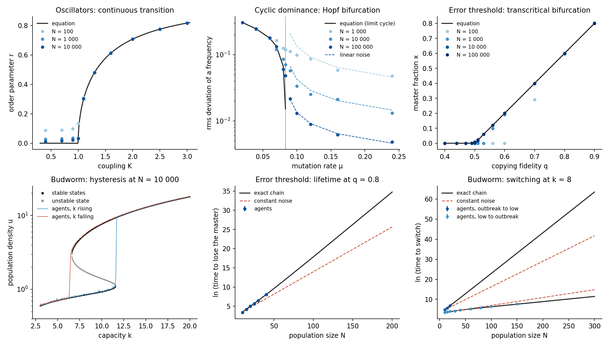

# Module 17. Populations: order parameters, transitions and chaos

**Learning objectives.** After this module you can

1. write the macroscopic equations of a population as a specification, with a parameter of the population (a
   coupling, a mutation rate, a copying fidelity) as the control;
2. locate the transitions along that parameter, and tell a continuous transition from a discontinuous one with
   hysteresis;
3. read the observable that characterizes the new state from the critical direction at the transition;
4. compare the results with the values that the equations give exactly, and recognize what the calculation does not
   cover;
5. tell which predictions of the equations survive in a finite population of agents, and why the rate of a rare
   switch needs more than a constant noise.

**Prerequisites.** [Modules 1](15_memory_first_card.md) and [2](16_memory_specification.md) for the card and the
specification, [Module 16](36_memory_chaos_and_blow_up.md) for the chaos test. **Time.** About 30 minutes of reading;
each card takes a few minutes.

## 1. From a population to a few variables

A population of many agents is often described by a few macroscopic variables: the frequencies of its traits, a mean
resource, the degree of order among its members. When these variables obey closed equations in the limit of a large
population, a parameter of the population plays the role of the control of a material. A write point of the card is
then a transition of the population. In a finite population the same equations become sharp only in the limit, and
the fluctuations of the population enter as noise of intensity proportional to 1/N.

The five models of this module have transitions that are known exactly, so that each result can be compared with the
equations. The specifications are in `examples/memory/populations` and `examples/dynamics`.

```bash
python3 -B -m fieldbridge memory card examples/memory/populations/kuramoto_population.json --quick --out-dir build/pop_sync
python3 -B -m fieldbridge memory card examples/memory/populations/cyclic_dominance_mutation.json --quick --out-dir build/pop_cycle
python3 -B -m fieldbridge memory card examples/memory/populations/error_threshold.json --quick --out-dir build/pop_error
python3 -B -m fieldbridge memory card examples/memory/populations/spruce_budworm.json --quick --out-dir build/pop_budworm
python3 -B -m fieldbridge memory dynamics examples/dynamics/food_chain.json --time 20000 --transient 5000 --dt 0.02 --out-dir build/pop_chain
```

| Population | Parameter | Calculated | From the equations |
| --- | --- | --- | --- |
| Oscillators with Lorentzian frequencies of half-width Δ = 0.5 (Kuramoto, Ott–Antonsen reduction) | coupling K | two directions become critical together at K = 1 | K<sub>c</sub> = 2Δ = 1 |
| Three strategies in cyclic dominance with mutation; win 1, loss 1.5 | mutation rate μ | Hopf bifurcation at μ = 0.0833, frequency 0.722 | μ = (b − a)/6 = 0.0833, √3(a + b)/6 = 0.722 |
| Master sequence on a single-peak landscape, f<sub>0</sub> = 2 | copying fidelity q | transcritical bifurcation at q = 0.499 | q = 1/f<sub>0</sub> = 0.5 |
| Spruce budworm, r = 0.55 | capacity k | folds at k = 6.60 and k = 11.6 | k = 6.596 and 11.582 |
| Three-species food chain, b<sub>1</sub> = 3 (Hastings–Powell) | none in the chaos test | λ<sub>1</sub> = 0.00705; predictability slope × λ<sub>1</sub> = 0.987 | the law gives 1 |

## 2. A continuous transition and its order parameter

For a Lorentzian distribution of natural frequencies, the mean field z = ⟨e<sup>iθ</sup>⟩ of the Kuramoto model obeys
a closed equation in the frame of the mean frequency (Ott and Antonsen, 2008),

$$\dot z = \left(\frac{K}{2} - \Delta\right) z - \frac{K}{2}\,|z|^2 z .$$

The incoherent state z = 0 loses stability at K<sub>c</sub> = 2Δ, and above it r = |z| = (1 − 2Δ/K)<sup>1/2</sup>. The card
reports both critical directions at the transition, because the equation does not change under a rotation of z. Above
K<sub>c</sub> the sampled starts settle on a circle of states with one flat direction: the modulus r has a restoring
force and the collective phase has none, so that in a finite population the phase diffuses (Law 2). The order
parameter is therefore the modulus of the critical direction, and what remains free is its phase.

## 3. An oscillating population

In the replicator equation with mutation, three strategies that beat one another in a cycle have the symmetric state
x = y = z = 1/3 with eigenvalues (b − a)/6 − μ ± i√3(a + b)/6. For a loss larger than a win, mutation holds the
population at fixed frequencies only above μ = (b − a)/6. Below that value the frequencies follow a limit cycle: the
card at μ = 0.05 finds a transverse Floquet multiplier of 0.48, so that the cycle is isolated. A cycle of this kind
keeps its phase as a neutral direction ([Module 6](20_memory_phase.md)) and can take the phase of a periodic
environment ([Module 11](26_memory_phase_locking.md)).

## 4. The error threshold

A master sequence of relative fitness f<sub>0</sub>, copied with fidelity q, obeys
ẋ = x(f<sub>0</sub>q − 1 − (f<sub>0</sub> − 1)x) when mutants do not mutate back (Eigen, 1971). The state x = 0 and the
state x\* = (f<sub>0</sub>q − 1)/(f<sub>0</sub> − 1) exchange stability at q = 1/f<sub>0</sub>, and below it the master
sequence is lost. The quadratic term of the normal form distinguishes this transcritical bifurcation from a pitchfork:
near the threshold x\* grows linearly with the distance from it, not as its square root.

## 5. A discontinuous transition with hysteresis

The budworm equation u̇ = ru(1 − u/k) − u²/(1 + u²) (Ludwig, Jones and Holling, 1978) has its folds on the curve
r = 2u³/(1 + u²)², k = 2u³/(u² − 1). At r = 0.55 a low and an outbreak population coexist between k = 6.60 and
k = 11.6. A forest growing past the upper fold starts an outbreak, and the population returns to the low state only
when the capacity falls below the lower fold. Between the two, the states are exchanged by activation (Law 3), at a
rate that falls exponentially as the noise decreases, and so as the population grows.

At r = 0.5 exactly the second fold is at infinite capacity, because u = 1 then solves the first relation: the low
state never vanishes, and there is no closed loop. The value of a parameter can in this way decide whether a transition
is reversible at all.

## 6. Chaos

The card has no test of chaos: it locates the Hopf bifurcation of the food chain at b<sub>1</sub> = 2.11 and calls the
motion at b<sub>1</sub> = 3 a cycle. `memory dynamics` decides the question. Its default run
of 1500 time units is too short for this model, whose exponent λ<sub>1</sub> ≈ 0.007 gives only ten e-foldings in that
time, and it returns "not chaotic". A slow system needs the options `--time`, `--transient` and `--dt`. With a run of
20000 the six starts agree, and the separation times follow the predictability law of Module 16.

## 7. The equations against populations of agents

The equations above are limits. To test them, `examples/population_agents/compare.py` simulates each population as
individual events, without using its mean-field equation: oscillators coupled through their mean field, agents that
copy one another with a probability set by their payoffs and sometimes mutate, sequences that replicate with errors
and replace one another, and budworms that are born, crowd and are eaten.

```bash
python3 -B examples/population_agents/compare.py --quick --out build/agents.json
python3 -B examples/population_agents/figure.py build/agents.json build/agents.png
```

The full run takes about four hours on four cores, and its output is saved as
`examples/population_agents/results.json`. The quick run omits the largest populations.



**Where the transitions are, and what lies beyond them.** The upper panels show that the agents converge on the
equations. Above K = 1, r agrees with (1 − 2Δ/K)<sup>1/2</sup> within 0.001 at N = 10000. Below it, r is not
zero but a fluctuation that falls with population size, close to the N<sup>−1/2</sup> of independent phases. A prepared
coherent state relaxes at the rate of the closed equation; the fitted rates (0.400, 0.253, 0.154, 0.105 and 0.054) exceed
Δ − K/2 because the cubic term still acts at the amplitudes of the fit, and integrating the equation over the same range
gives the same excess. With noise on each oscillator, the collective phase diffuses with a coefficient close to
1/N (measured exponent −1.04). The frequency of the limit cycle of the strategies also agrees: it falls from 0.72 at
the Hopf bifurcation to 0.48 at μ = 0.02, in the agents as in the equation. The master fraction follows x\* at large N,
apart from q = 0.5 itself, where x decays only as a power of time, and the runs at N = 100 and N = 1000 that lost the
master sequence within the run.

**A transition that a finite population blurs.** Above the Hopf bifurcation the equation has a fixed point and no
oscillation, whereas the agents keep cycling: their noise excites the damped rotation, at a frequency near 0.72. Each
frequency receives noise of intensity B = (2P + 4μ)/(9N), with P = a + b, from copying and mutation. This noise is
isotropic in the plane of the simplex, so the variance is B/(2(μ − μ<sub>H</sub>)), with no free constant. It accounts
for the dashed lines in the middle panel: the ratio of measured to predicted variance lies between 0.92 and 1.09 at
N = 100000. It fails at N = 1000 close to the bifurcation, where the amplitude is no longer small. The apparent transition
is therefore shifted and rounded by an amount that decreases with N.

**Delay at a fold, and activation before it.** Sweeping the capacity gives the hysteresis loop of the budworm, and two
effects compete in where the jump occurs. At large N the population passes the fold and leaves late. With a sweep from
3 to 20 in a time T, the jump upward at N = 100000 is at k = 12.54 for T = 2000 and 11.79 for T = 20000, and integrating
the equation gives 12.51 and 11.79 (fold at 11.58). This is the delay law of [Module 10](25_memory_threshold_write.md): over T from 2000 to 200000 the
equation gives exponents of 0.66 and 0.62 for the upward and downward folds, approaching 2/3. At small N the population
leaves early, by activation inside the bistable range. The time τ(k) to reach the threshold at fixed k follows exactly
from the rates of the chain, and the median jump is where ∫dk (T/17)/τ(k) = ln 2. For T = 20000 this gives 8.08, 9.67
and 10.83 at N = 100, 300 and 1000, and repeated sweeps give 8.14, 9.61 and 10.79, each with a standard error of 0.06
to 0.09. Hysteresis measured in a finite population therefore depends on both N and the rate of the sweep, and it
closes as N decreases or the sweep slows.

**Where constant noise fails.** The time to leave a state grows as exp(NS). In a birth–death process the exponent is
S = ∫ln(d/b)dx against the drift, and the lower panels confirm it: simulated times agree with the exact mean
first-passage times of the chain, and the slope of the exact curves at large N approaches S. A specification has a
constant noise, which gives ΔV/D instead. Taking D from the rates at the state being left gives

| Escape | S from the rates | Noise D(x) = (b + d)/2N | Constant noise |
| --- | --- | --- | --- |
| Budworm, low state to outbreak, k = 8 | 0.0259 | 0.0259 | 0.0393 |
| Budworm, outbreak to low state, k = 8 | 0.2032 | 0.2032 | 0.1272 |
| Master sequence lost, q = 0.8 | 0.1725 | 0.1706 | 0.1166 |

The error is not a matter of choosing D. Fluctuations in a population grow with its density, so that the outbreak state
is noisier than the low state, and no single D gives the ratio of the two exponents: for a constant D that ratio is
0.048, and the rates give 0.127. The capacity at which the two states are equally occupied, which does not depend on the
value of D, also moves: it is k = 6.95 with constant noise, and 7.13 from the rates, the value to which the stationary
distribution of the chain converges (7.17, 7.14, 7.13 at N = 100, 300, 1000). The table also shows the remedy. Keeping
the dependence of the noise on the state recovers the exponent almost entirely in these examples, without the full
chain.

The predictions of a card therefore fall into two groups for a population. The location and kind of each transition,
the order parameter, the relaxation rate, the phase diffusion and the delay at a fold are properties of the drift, and
the agents reproduce them. The rates of rare switches depend on the noise, so the activation times of a card with
constant noise are not quantitative for a population, in value or in which state is preferred.

## 8. What the calculation does not cover

- **Transitions on the boundary of an orthant.** A state with a variable at exactly zero is not continued, because the
  drift there need not be smooth. An extinction or invasion threshold is therefore missed on the carrier `orthant`. The
  error threshold is written on `euclid` for this reason, and its card reports trajectories that do not settle: they
  are starts at negative x, outside the physical range, which diverge. They are not an oscillation.
- **Rotations in the structural predictions.** `memory predict` looks for continuous symmetries that are translations,
  so it does not see the rotation of z, and its retention prediction for the oscillators disagrees with the calculation.
- **Finite populations.** The noise intensities of these files are constant and chosen for the examples. Section 7 shows
  what this leaves out: the activation times of a population need a noise that depends on the state.

## 9. Applying this to another population

Choose a few macroscopic variables, derive or fit their dynamics as functions of the parameters of the population, and
write them as a specification ([CONTRIBUTING.md](../../CONTRIBUTING.md)). The card then gives predictions that a
simulation of the agents can test: the location and kind of each transition, hysteresis between upward and downward
sweeps, the slowing down near a transition, where the relaxation rate κ goes to zero, and the growth of switching
times with population size.

Sources: Kuramoto (1975), Ott and Antonsen (2008), Hofbauer and Sigmund (1998), Mobilia (2010), Eigen (1971), Ludwig,
Jones and Holling (1978), Hastings and Powell (1991), McKane and Newman (2005, quasi-cycles), Doering, Sargsyan and
Sander (2005, extinction times).
