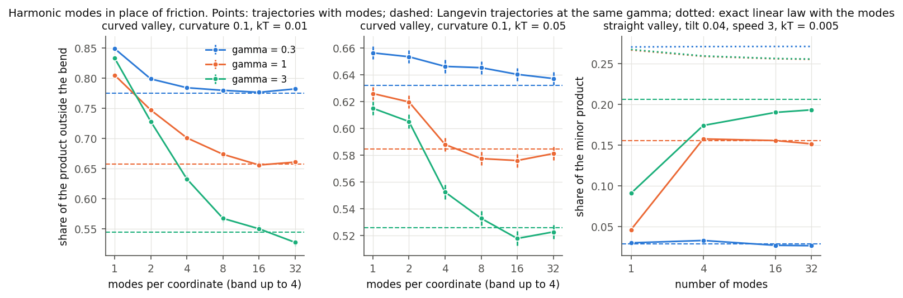
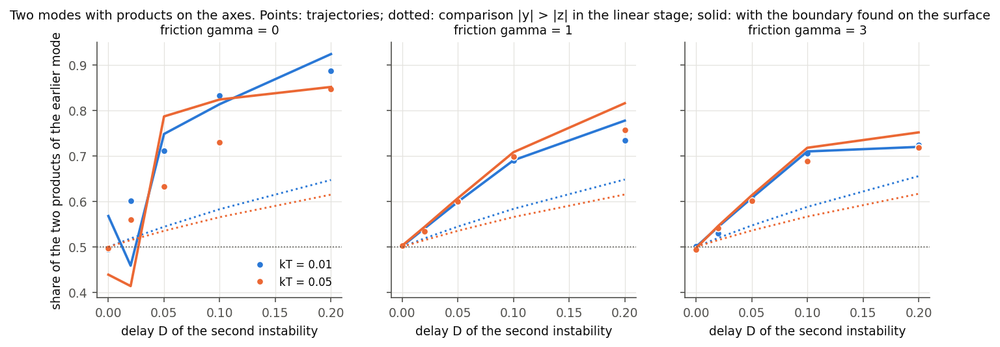
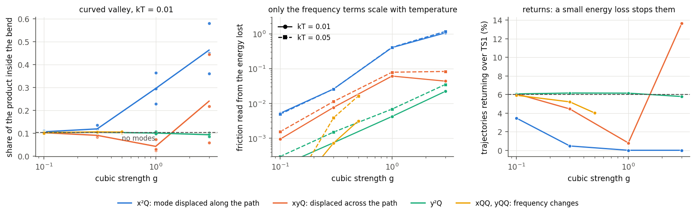
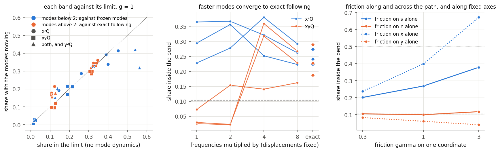
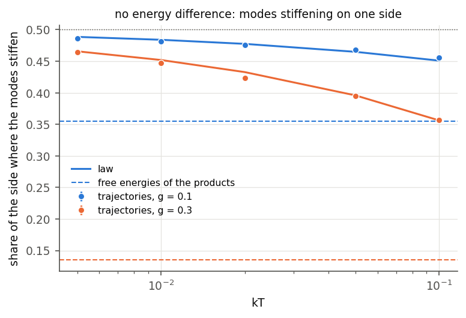
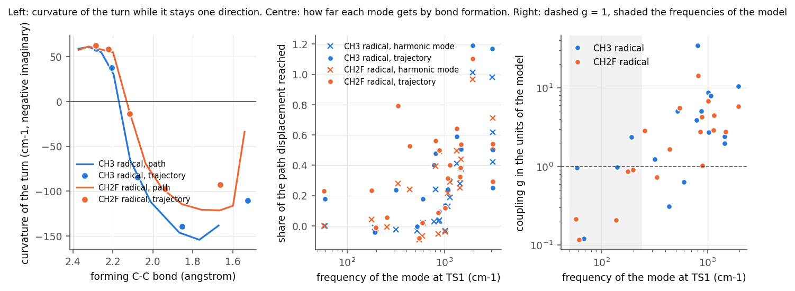
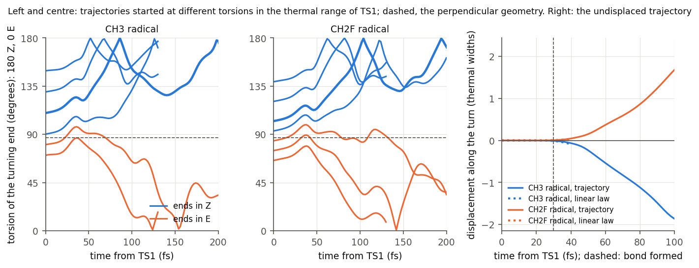

# Product branching after a valley-ridge inflection and the swept-pitchfork write law

## Question and answer

After a transition state (TS1), a reaction path can reach a valley-ridge inflection (VRI), where the curvature across
the path changes sign and one valley becomes two. Seen from the coordinate across the path, this is a pitchfork
bifurcation swept by the motion along the path. The question was whether FieldBridge's write law for a swept pitchfork
with a bias and noise predicts the product ratio. The law states that, while the displacement across the path is
small, the displacement is Gaussian and its sign is set by the mean pushed by the asymmetry divided by the spread:
P = Phi(h I1 / sqrt(sigma0^2 + 2 D I2)). The test used two model surfaces, not molecules.

The answer has seven parts.

1. When friction slows the motion along the path, the law predicts the ratio from static quantities of the surface
   and the incoming speed. Static here means the transverse force and the transverse curvature along the path, and
   the offset and frequency of TS1. The error is about half a per cent, on our minimal surface and on the surface of
   Collins et al. (2013).
2. In a conservative passage (no friction), the decision is not finished while the displacement is small. The
   trajectories are then more selective than the law, by 10-30 per cent in probit for thermal incoming speeds and by
   up to a factor of eight for fast fixed speeds.
3. The local Kondepudi-Nelson formula (constant pi^{1/4}) does not apply to these surfaces, because TS1 lies inside
   the time window in which the choice is made. The law has to be integrated along the path from TS1.
4. The two static classes of Yamaki et al. map onto the two sides of the unfolding of the bifurcation at the TS line,
   but only in a restricted sense, described in the class-mapping section. On the downhill side the write law holds.
   Where the valley of the minor product is born before the TS line, it has its own saddle above TS1, and the
   transition-state split of the Boltzmann weight on the TS line holds. Next to the boundary neither holds.
5. On a curved path, the centrifugal force kappa <s'^2> is a bias that no static quantity records. On a valley whose
   IRC, saddles and minima are all symmetric, trajectories favour the product outside the bend by up to 99:1. The law
   predicts the direction and size of this effect, but only to 0.02-0.12. A pseudo-minimum before the VRI leaves the
   ratio unchanged unless its exit saddle lies near the TS1 level. Even then the ratio is set by the descent after
   that saddle, and the law applies from it.
6. Harmonic modes act as the friction in the law once their recurrence time exceeds the passage time, and slow modes
   do not count. Two transverse modes give four products. They decide independently when the products lie in the
   quadrants. When the products lie on the axes the earlier mode wins by more than the linear stage says, and the
   boundary between the families has to be found on the surface.
7. Cubic coupling to further modes, which is what a molecule has in place of linear coupling, does not act as the
   friction in the law. Terms that change the frequency of a mode give friction proportional to temperature, but they are
   too weak to move the ratio before the mode loses its binding. Terms that displace a mode along the path are strong and
   do not depend on the population of the modes. A fast mode then adds inertia, a slow mode cannot follow and leaves the
   trajectory on a surface that is not relaxed, and energy is lost for good only to modes in between. The ratio then depends
   on which modes are coupled and not on one friction number.
8. DFT on two radical additions to methylallene gives what those rows contain in a real molecule. Slow couplings have g near 1,
   as in the model, but the passage takes 30 fs, so almost every mode stays behind or lags. Staying behind does not delay the
   instability, which starts at the same bond length on the trajectory as on the relaxed path. The sweep hardly amplifies anything.
   The product follows the side of a perpendicular torsion on which the molecule starts, and a thermal width at TS1 then gives
   shares of 0.81 to 0.91 and 0.67 to 0.81, against 0.956 and 0.823 counted by Wu et al. (no ensemble was run).

The transfer is partly prior art. Tao, Qiu and Subotnik (2023) gave the overdamped Gaussian ratio of a biased mean to
the thermal width before the VRI. The swept-pitchfork law along the path, its inertial and conservative forms, and the
class mapping were not found (see [PRIOR_ART.md](PRIOR_ART.md)).

## Models, the law and the trajectories

**Surfaces** ([ptsb.py](ptsb.py)). Masses are one.

- **Minimal surface:** V = 8/3 x^3 - 4x^2 + y^2/2 + (x - d) y^2 (y^2 - 2), with TS1 at the origin, the VRI at
  x = 1/4 + d, a ridge saddle TS2 at (1, 0) 1.33 below TS1, and two product minima 1.95 below TS1. Three
  asymmetries are added:
  - a tilt eps y, which is a uniform force across the path;
  - a cubic term c x y^3, which makes the two product valleys differ in shape and depth but puts no force on the
    line y = 0;
  - a shift d of the VRI through the TS line.
- **Collins surface:** the surface of Collins, Carpenter, Ezra and Wiggins, J. Chem. Phys. 139, 154108 (2013),
  eq. (2.1), for x* = 2.00, 2.05 and 2.10. The coefficients reproduce their Tables I and II and their IRC endpoints.

**The law along the path.** The reference path x_ref(t) runs along y = 0 from TS1 at the incoming speed, with
friction gamma. Linearizing across the path gives

    y'' = -gamma y' - V_yy(x_ref, 0) y - V_y(x_ref, 0) + sqrt(2 gamma kT) xi(t).

The mean, the response to the initial state and the noise covariance of this equation are integrated together. The
initial state is the transverse equilibrium at TS1: thermal, a Wigner Gaussian, or the quasiclassical normal-mode
ellipse.

- For a Gaussian initial state, P = Phi(mean/spread) at the largest amplification.
- For normal-mode sampling (fixed energy and a uniform phase) the distribution is not Gaussian but an arcsine:
  P = 1/2 + arcsin(m/A)/pi, averaged over the Boltzmann distribution of quanta.
- In the overdamped limit the law reduces to Kondepudi-Nelson. On this surface the noise ratio is Gamma = kT/6
  whatever the friction.
- For a conservative passage entered adiabatically, it reduces to P = Phi(pi^{1/2} f / (J R)^{1/2}). Here f is the
  transverse force, J the mean transverse action at entry and R the rate at which the transverse stiffness falls.
  [airy_check.py](airy_check.py) confirms this against the linear equation to within 0.0035 (0.0004 for an entry far
  from the VRI).

**Trajectories** ([engine.py](engine.py), [scan.py](scan.py)). Trajectories use BAOAB Langevin dynamics, or velocity
Verlet without friction, with dt = 0.005. They start on the dividing line through TS1. A trajectory is assigned at
its first entry into a product basin, with the side read from the TS2 ridge. Family E, Collins's own protocol, also
assigns by the well occupied at the end, which is their definition. Trajectories that return over TS1 are excluded
from the ratio, and their share is recorded. The scan has 376 parameter points and 3.46 million trajectories, run on
one RTX 3090 in 244 s. The laws come from the surfaces alone (`scan.py law`).

## Results

### With friction, the law predicts the ratio

**Minimal surface with a tilt** (125 points: five frictions, five temperatures, five tilts, thermal incoming speeds).
The table gives the mean and largest difference between the trajectory share and the law.

| gamma | mean abs(dP) | largest abs(dP) | median z_traj / z_law |
|---|---|---|---|
| 0.3 | 0.004 | 0.010 | 1.02 |
| 1 | 0.005 | 0.015 | 1.02 |
| 3 | 0.004 | 0.014 | 1.00 |
| 10 | 0.004 | 0.011 | 0.99 |

**Collins surface** (63 points). For gamma from 0.5 to 5 the mean difference is 0.004-0.005 and the largest 0.011.

**Temperature.** For a tilt, selectivity falls with temperature, because the push is fixed while the thermal width
grows. At eps = 0.08 and gamma = 1, the share of the favoured product falls from 0.92 at kT = 0.005 to 0.62 at
kT = 0.1. The law follows the trajectories at every temperature.

**The local formula.** At gamma = 10 the local Kondepudi-Nelson formula gives a probit about 0.71 times that of the
law along the path, while the trajectories agree with the path law. Examples:

| kT | eps | trajectories | path law | local formula |
|---|---|---|---|---|
| 0.005 | 0.08 | -1.36 | -1.35 | -0.96 |
| 0.02 | 0.08 | -0.66 | -0.68 | -0.48 |

The local formula assumes a sweep that starts far before the VRI. Here TS1 sits 0.25 before the VRI, inside the
decision window, whose length is about (dx/dt) r^{-1/2} = 0.61. The offset of TS1 from the ridge line, relative to
the thermal width at TS1, carries much of the decision. This is why TS-geometry predictors (bond-length differences,
lateral offsets) work as well as they do.

**FieldBridge.** The overdamped transverse model is the specification
[ptsb_transverse_overdamped.json](ptsb_transverse_overdamped.json), with the path coordinate as the control.
- `memory noise-ratio` finds a continuous pitchfork at s = 1/4 with cubic coefficient -1. Its measured constants are
  1.20 +- 0.12 at Gamma = 0.05 and 1.43 +- 0.12 at Gamma = 1, against pi^{1/4} = 1.33.
- `memory codiscover --target symmetric-write` reaches the symmetric write, with derivation
  S(reflection) C R(pitchfork) K L and constant 1.29 +- 0.11.

Reports: [fieldbridge_noise_ratio](fieldbridge_noise_ratio/noise_ratio.md) and
[fieldbridge_codiscover](fieldbridge_codiscover/).

### The force on the path decides, not the depths of the wells

The cubic term makes the two product wells differ by 0.15, 0.31 and 0.64 in energy, but puts no force on the line
y = 0. The law therefore predicts 1/2. The trajectories give 0.476-0.517 at all temperatures and both frictions
(24 points, largest deviation 0.024). A Boltzmann ratio of the product wells would give more than 99.9 per cent for
the deeper well at the lowest temperatures.

### The conservative passage is more selective than the law

Without friction the median ratio z_traj / z_law is 1.11 on the minimal surface and 1.32 on the Collins surface
(thermal speeds). With fast fixed speeds the gap grows, as the table shows for kT = 0.005 and eps = 0.04 on the
minimal surface.

| incoming speed | trajectories P+ | law P+ | returned over TS1 | amplification before the wall |
|---|---|---|---|---|
| 0.3 | 0.212 | 0.253 | 7 per cent | 3.0 |
| 1 | 0.113 | 0.262 | 34 per cent | 2.5 |
| 3 | 0.033 | 0.272 | 48 per cent | 1.9 |

The mechanism is visible in these numbers. Between the VRI and the far wall, the growing transverse solution is
amplified only two- to threefold. The displacement therefore reaches the size of the wells before its sign is fixed,
and the asymmetry keeps acting in the nonlinear motion. Trajectories that have not left the ridge region bounce back
over TS1. Those that reach a product on the first pass are the ones displaced early, which is mostly toward the
favoured side.

Collins et al. reached the same picture from bundle dynamics. They found that the far wall, not the VRI, decides,
except under strong dissipation. Friction of order one (gamma about 0.3 on the minimal surface and 0.25-0.5 on the
Collins surface) slows the motion along the path enough for the linear stage to finish, and the law then holds.

### First entry against the well occupied at the end

This is Collins's protocol: a fixed energy above TS1, damping without noise, 60 points. The law predicts the
first-entry ratio with a mean error of 0.013 (largest 0.032) at every damping. The well occupied at the end departs
from the first entry for gamma below about 0.3. For x* = 2.05 and E = 0.01 it is 0.27 at gamma = 0.1 and 0.77 at
gamma = 0.2, while the first entry stays at 0.53-0.54. This is the non-monotonic dependence on friction that Collins
et al. reported. It arises from ridge recrossings after the first entry, which the law does not describe.

### Zero-point motion

The transverse mode carries only its zero-point energy (hbar omega / 2 = 0.02). Two samplings with the same mean
energy give different ratios:

- At gamma = 3 and eps = 0.04, P+ is 0.390 with normal-mode sampling (fixed energy) and 0.320 with Wigner sampling
  (Gaussian).
- The arcsine law and the Gaussian law reproduce each case, with a largest error of 0.011.
- Fixed-energy sampling is less selective at small bias. It becomes completely selective once the push exceeds the
  amplitude of the zero-point ellipse, which a Gaussian never does.

Without friction both samplings are again more selective than their laws (largest error 0.076).

## The static classes and the unfolding

**Strings on these surfaces** ([classes.py](classes.py), results/classes.json). We ran a converged double-ended
string from TS1 to the product the IRC does not reach.

- On every asymmetric surface, the string descends into the valley of the IRC product and climbs over TS2.
- Its "small barrier" is therefore TS2 seen from that dip. On the minimal surface it is 0.001-0.71 above the dip and
  its top lies 1.30-1.33 below TS1. On the Collins surface it is 1.5-2.6 above the dip and 3.97 below TS1.
- The string is downhill only where the IRC runs along the ridge to TS2: the symmetric surface, and the cubic family,
  which has no force on the path.

On these surfaces, then, the string class records whether the IRC ends at the ridge saddle, not how the minor valley
is born. Every surface in this family has its only other saddle (TS2) below TS1, so no string from TS1 can have a
maximum above TS1. The small barrier 0.27 kcal/mol above TS1 that Yamaki et al. report for their entry 28 needs a
second saddle near the TS line.

**The cusp at the TS line.** Moving the VRI behind the TS line (d < -1/4) supplies that saddle. At eps = 0.02 the
fold that creates the minor valley crosses the TS line at d = -0.287. Behind it, TS1 has a partner TS1' for the minor
product, 0.012-0.024 above TS1, with a hill between the two (an index-2 saddle) 0.013-0.077 above TS1. That hill is a
small barrier above TS1 in Yamaki's sense.

Family F has 66 points. It uses the full Boltzmann weight on the TS line, two frictions and three temperatures.

| Side of the cusp | Prediction | Mean abs(dP) | Largest abs(dP) |
|---|---|---|---|
| Downhill, d >= -0.22 (minor valley born after the TS line) | write law | 0.007 | 0.027 |
| Two saddles, d <= -0.35 | TS split of the Boltzmann weight | 0.006 | 0.020 |
| Next to the boundary, d = -0.30 | TS split | 0.050 | 0.062 |

At d = -0.30 the trajectories carry more of the minor product than the static split: 0.207 against 0.168 at
kT = 0.01. The trajectories vary smoothly across the boundary.

**Where the mapping holds and where it does not.**

- A downhill connection, in the sense of a minor valley born at a fold or pitchfork after TS1, corresponds to the
  write law. A small barrier above TS1, in the sense of a minor valley born before the TS line with its own saddle,
  corresponds to transition-state selection. Both selectivities fall with temperature, for different reasons: the
  thermal width against a push, and a Boltzmann factor.
- This is the crossover that FieldBridge's noise ratio describes between the linear stage and the activated regime.
  Here the place where the barrier between the valleys appears plays the role of Gamma.
- The mapping fails in a band of about 0.05 in d around the boundary, where neither the law nor the split holds.
- It fails for "small barriers" that are only TS2 seen from the major valley. Those lie below TS1 and say nothing
  about the birth of the minor valley.
- It is a statement about these two-dimensional surfaces. Curved paths and pseudo-minima are treated in the next
  section; molecules with additional modes were not modelled.

## A curved path and pseudo-minima before the bifurcation

**Surface** ([curved.py](curved.py)). The minimal surface is written in coordinates s along the valley and n across
it, and the valley is laid along a circular arc of curvature kappa. The potential depends on (s, n) exactly as on the
straight surface. The stationary points, their energies, the IRC and every static quantity along the path are
therefore unchanged by the curvature. With no tilt, the IRC runs along the valley floor to the ridge saddle TS2, and
the two products have the same energy. The curvature enters only through the kinetic energy. In this family the VRI
sits at s = 1/2 (d = 0.25). Static analysis predicts 50:50 for every curvature.

**The law along a curved path.** Linearizing the equations of motion about the reference path gives

    n'' = -gamma n' - [V_nn - kappa^2 v^2] n - V_n - kappa <s'^2> - 2 kappa v dv + noise.

The term kappa <s'^2> is the centrifugal force toward the outside of the bend. It acts as the bias of the write law,
and it is set by the kinetic energy along the path, not by the shape of the surface. This is Carpenter's dynamic
matching expressed as a bias. With strong friction <s'^2> falls to kT, and the bias becomes the entropic force
kappa kT of the larger room outside the bend. The fluctuations of the speed dv are integrated with the transverse
motion.

### Curvature alone selects the outside product

- **Size of the effect.** Without friction, at kT = 0.005, the share of the product outside the bend is 0.64, 0.81,
  0.97 and 0.99 for curvature 0.02, 0.05, 0.1 and 0.2.
- **Temperature.** The selectivity falls as temperature rises. At curvature 0.1 without friction, the outside share
  is 0.97 at kT = 0.005 and 0.62 at kT = 0.1. The push comes from the kinetic energy gained in the descent from TS1
  to the VRI, which does not depend on temperature, while the thermal width across the path grows.
- **Incoming speed.** Faster arrival strengthens the push. At curvature 0.05 and kT = 0.005, fixed incoming speeds
  of 0.3, 1 and 3 give 0.82, 0.93 and 1.00.
- **Friction.** Friction removes the effect, because it removes the kinetic energy that carries the push. At
  gamma = 10, every curvature and temperature gives 0.49-0.52.

**Curvature against a force toward the inside** (family H, curvature 0.1).

- **Friction reverses the favoured product.** With an inward tilt of 0.04 at kT = 0.005, 83 per cent of products are
  outside without friction and 48 per cent with gamma = 1. The tilt is a static force, which friction does not
  weaken, while the centrifugal push is lost.
- **Temperature reverses it weakly at the strongest tilt.** With an inward tilt of 0.08 and no friction, the outside
  share is 0.56 at kT = 0.005 and 0.485 at kT = 0.1. The law predicts 0.52 at every temperature, with no reversal.

**Accuracy of the law.** The law gives the direction and size of the effect. Its accuracy is set by where the
decision is read: at the largest amplification beyond the VRI, as on the straight surfaces (fixed before the
comparison), or at the first contact of the reference path with the product wall (chosen after it). The table gives
the mean absolute difference between the trajectory share and the law, over 20 points per row.

| friction gamma | read at largest amplification | read at first wall contact |
|---|---|---|
| 0 | 0.038 | 0.058 |
| 0.3 | 0.124 | 0.028 |
| 1 | 0.039 | 0.009 |
| 3 | 0.037 | 0.035 |
| 10 | 0.020 | 0.020 |

For a tilt on the same surfaces, the readout does not matter and the law holds to 0.005-0.02 (families I and J
below). For curvature it does. The push kappa v^2 is largest at the bottom of the descent and near the product wall,
where the transverse motion is no longer small. At gamma = 0.3, reading at the largest amplification includes the
return of the reference path from the wall, after the trajectories have already entered a product. With friction the
trajectories are less selective than the law: by 0.04 on average at gamma = 3 and 0.02 at gamma = 10, and by at most
0.10.

The reason is a second-order effect of the curvature. The inside of the bend is shorter, so a trajectory displaced
inward runs ahead along the path. It reaches the unstable region earlier and is amplified more, which acts as a push
toward the inside. A Gaussian closure of this term has the right sign at gamma = 10 (0.540 becomes 0.521, against
0.508 from trajectories). The closure grows with the transverse variance, however, and diverges at gamma <= 1. It is
kept in the code as an option and is not used.

### A pseudo-minimum on a downhill path changes nothing

**Setup** (family I). A Gaussian dip of depth a sits at s = 0.25, before the VRI.
- For a < 0.2 the dip is a shoulder.
- For a >= 0.2 it is a true intermediate, with an exit barrier of 0.01-0.07. Its exit saddle lies 0.42-0.45 below
  TS1.

**Result.** The ratio does not change.
- At every friction (0 to 3) and temperature (kT 0.02 and 0.05), the outside share varies by at most 0.017 over
  a = 0-0.3 on the curved valley and 0.021 on the straight valley with a tilt.
- Trajectories cross the dip with the energy of the descent from TS1. Only at gamma = 3 and a = 0.3 are more than
  10 per cent held beyond t = 10 (18 per cent).

**Law.** The law from TS1 needs no change while its reference passes the dip.
- For the tilt it holds to 0.004-0.015 at every friction.
- For curvature it carries the readout errors of the previous section.

### An intermediate held by an exit saddle at the level of TS1

**Setup** (family J). An intermediate lies 0.1 below TS1, between TS1 and an exit saddle TS1b at the level of TS1,
or 0.02 or 0.04 below it. The VRI follows at s = 0.7.
- At gamma = 1 and kT = 0.02, 42-69 per cent of trajectories decide after t = 10. At kT = 0.02 and gamma >= 0.1, up
  to 11 per cent are still in the well at t = 300; those are excluded from the ratio.

**Results**
- **The held intermediate reduces the outside share only modestly.**
  - At curvature 0.1 and kT = 0.02 the reduction is from 0.91 to 0.81-0.83 at gamma = 0.1, and from 0.64 to
    0.61-0.63 at gamma = 1.
  - Without friction the reduction is from 0.89 to 0.84-0.86. This is consistent with the transverse energy
    picked up in the well.
- **Held trajectories choose like the rest.** At gamma = 1 with the exit saddle at the level of TS1, the trajectories
  decided after t = 10 have outside share 0.61, against 0.62 for the earlier ones (0.57 against 0.56 for the tilt).
  The outcome is set after the exit saddle.
- **Why the push survives.** Without friction, the kinetic energy at the VRI is the total energy minus the potential
  there. Whatever happens before the last saddle, the trajectories leave TS1b with nearly the same energy and gain
  the same speed on the way down. The centrifugal push is acquired downhill of the last saddle, so an intermediate
  cannot erase it. It can only add transverse energy, or give friction more time to act.

**Law.** The law started at TS1b, with thermal speeds and the thermal transverse state there:
- holds at gamma = 1 to 0.006 for curvature and 0.005 for the tilt;
- for the tilt, holds to 0.005-0.021 at every friction;
- for curvature at gamma <= 0.1, the trajectories exceed it by 0.10-0.12. This is the conservative excess seen on
  all surfaces.

### What this adds to the class mapping

- **Path curvature.** A curved path is a source of selectivity that no static quantity records. On these surfaces
  the IRC, the stationary points and their energies are those of a symmetric bifurcation, while trajectories favour
  the outside product by up to 99:1.
- **Pseudo-minima.** A pseudo-minimum or shallow intermediate before the VRI does not change the ratio, unless its
  exit saddle lies near the TS1 level and friction is present.
- **Even then.** The ratio is fixed by the descent after the exit saddle. The law applies from that saddle, as if it
  were TS1.

## Friction from explicit modes, and more than two products

### Harmonic modes in place of Langevin friction

**Setup** ([bath.py](bath.py), [bath_scan.py](bath_scan.py)). Each coordinate is coupled to its own M harmonic modes,
with a discretized Ohmic spectrum up to a frequency of 4 that corresponds to a friction gamma. The whole system is
conservative. The only noise is the thermal distribution of the modes at the start. This asks whether a molecule's
own modes can supply the friction the law needs. On the straight surface the linear stage including the modes is
solved exactly, with no Markov approximation.

**A test that could not fail.** On the straight valley with tilt 0.04 at thermal speeds, trajectories with any number
of modes agree with the law to 0.003-0.009. This says little, because the ratio barely depends on friction there. It
is 0.30 even at gamma = 0 for kT = 0.01, since the offset of TS1 sets it. Two tests where friction changes the answer
are needed.

**Tests where friction matters.** The table gives the mean absolute difference from Langevin trajectories at the same
gamma.

| modes per coordinate | curved valley (curvature 0.1, thermal speeds, 6 points) | straight valley, fast speeds 1 and 3 (6 points) |
|---|---|---|
| 1 | 0.111 | 0.063 |
| 2 | 0.072 | not run |
| 4 | 0.031 | 0.010 |
| 8 | 0.012 | not run |
| 16 | 0.006 | 0.005 |
| 32 | 0.006 | 0.007 |

- **How many modes are enough.** Modes act as friction once their recurrence time 2 pi M / 4 exceeds the time the
  trajectories take to reach a product. That time is 3-11 here (median to 90th percentile, in the curved-valley runs
  at gamma = 0.3-3). Eight modes recur at 12.6, and the difference is then about 0.01. Four modes recur at 6.3, which
  is inside the passage, and the difference is about 0.03. With too few modes the energy is not removed in time, and
  the outside share stays near its conservative value: at gamma = 3 and kT = 0.01 it is 0.83 with one mode and 0.55
  with Langevin friction.
- **Which modes count.** Slow modes do not act as friction. Thirty-two modes confined to frequencies below 1 leave the
  outside share 0.03-0.12 above Langevin at the same gamma. A band extended to 16 stays within 0.04.
- **The exact linear law does not close the fast-speed gap.** At speed 3 the law with the modes gives 0.26-0.27, and so
  does the Markov law, while trajectories give 0.03-0.19. The gap at fast speed is nonlinear, as with Langevin friction,
  and is not caused by the Markov approximation. This fast-speed gap also holds for Langevin friction at gamma up to 3,
  so the 0.005 accuracy reported above is a statement about thermal speeds.
- **Returns over TS1.** Fewer trajectories return with modes than with Langevin friction at the same gamma (1503
  against 1950 of 10000 at gamma = 3 and kT = 0.01). The ratio is unaffected. I did not determine the cause; the band
  ends at 4, close to the barrier frequency 2.83, which may reduce the friction acting on the barrier crossing.

### Two transverse modes: four products or three

**Setup** ([two_modes.py](two_modes.py), [two_modes_scan.py](two_modes_scan.py)). Two transverse modes y and z lose
stability along one path, y at x = 1/4 and z after a delay D. A quartic coupling c decides where the products lie.

**Products in the four quadrants (c = 0.5, 36 points).** Each mode decides its sign independently.
- The sign law of each mode holds to 0.004-0.009 on average (largest 0.024), including without friction and with a
  delay of 0.3.
- The share of a quadrant equals the product of the two sign shares to 0.002.
- Four products here are two independent two-product decisions.

**Products on the axes (c = 1.5, 90 points).** The mode that grows first suppresses the other, so the question is which
family wins.

- **The earlier mode wins by more than the linear stage says.** The first estimate compares |y| with |z| in the linear
  stage, P(|y| > |z|). At D = 0.1, gamma = 1 and kT = 0.01, it gives 0.58 while trajectories give 0.69. Reading the
  comparison later does not help: 0.57-0.60 for read amplitudes from 0.2 to 0.8.
- **Why.** The stiffness of z exceeds that of y by 4D along the whole path, including the nonlinear stage. The boundary
  between the families is therefore not at |y| = |z|. A trajectory with |z| somewhat larger than |y| still ends in the
  y family.
- **The boundary from the surface.** I added this after seeing the failure above; nothing is fitted. The linear stage
  gives the Gaussian (y, z) where the deviation reaches 0.2. A bisection on the angle in noise-free motion on the
  surface finds the direction separating the families, and the probability is the Gaussian weight on each side. At the
  same point it gives 0.69.
- **Not a Boltzmann split.** At D = 0.2 the z products lie 0.27 above the y products, which at kT = 0.01 would give
  essentially all y. Trajectories give 0.73.

| friction gamma | tilt on z | linear comparison | with the boundary |
|---|---|---|---|
| 0 | 0 | 0.129 | 0.077 |
| 0 | 0.05 | 0.055 | 0.054 |
| 0 | 0.2 | 0.054 | 0.091 |
| 1 | 0 | 0.062 | 0.014 |
| 1 | 0.05 | 0.036 | 0.009 |
| 1 | 0.2 | 0.014 | 0.039 |
| 3 | 0 | 0.058 | 0.011 |
| 3 | 0.05 | 0.034 | 0.011 |
| 3 | 0.2 | 0.011 | 0.044 |

(Mean absolute difference in the share of the y family over delays and temperatures, 10 points per row.)

**Limits of the boundary**
- **Strong tilt.** With a tilt of 0.2 on z, one z product is nearly empty, leaving three effective products (at
  gamma = 1, kT = 0.01 and D = 0: 0.00, 0.86, 0.07, 0.07). There the simple comparison does better than the boundary.
  I did not resolve why. The offset of z at TS1 is already 0.19, close to the amplitude 0.2 at which the boundary is
  read, which is a possible reason.
- **Without friction.** The boundary is not reliable. At D = 0 symmetry requires 45 degrees, and the bisection returns
  50 and 40 degrees, because the noise-free outcome is not a clean function of the angle after wall reflection.

## Cubic coupling to further modes

The harmonic modes of the previous section are coupled linearly to x and y. At a stationary point of a molecule the normal
modes are orthogonal, so the lowest coupling is cubic. The question here is whether those terms supply the friction of the
law during the passage. The code is [anharm.py](anharm.py) and [anharm_scan.py](anharm_scan.py).

### The model

The surface is coupled to M modes (16 unless stated, frequencies 0.5 to 8) through

    V = V0(x, y) + sum_j (1/2) w_j^2 (Q_j - a_j(x, y))^2 + (1/2) x Q^T A Q + (1/2) y Q^T B Q,
    a_j = (1/2) dxx_j x^2 + dxy_j x y + (1/2) dyy_j y^2.

The first group displaces a mode as (x, y) move. Its cubic terms are x^2 Q, x y Q and y^2 Q, and the square keeps the relaxed
surface at V0, so the IRC, the saddles and the minima do not change. The second group changes the frequencies of the modes.
Tables are sparse and random, with three partners per mode and the parity allowed by y -> -y. Each coefficient is g times the
square root of the frequencies involved times a standard normal number, which is the scaling that makes a cubic constant
the same size in dimensionless normal coordinates. The strength g is the only parameter. If frequency 1 is 150 cm-1 and
kT = 0.03 is room temperature, then g = 1 is a cubic constant of about 13 cm-1 for the x y Q term. This is an order-of-magnitude
estimate and it is not fitted to any molecule. Three tables were drawn for each point, with 10,000 trajectories on each. The
energy is conserved to 5e-4 root mean square or better, and the forces in path coordinates match numerical derivatives to 1e-9.

I used the two conditions where the previous section found the ratio to depend on friction (curved valley with curvature 0.1,
and tilt 0.04 at speed 3), and the tilted valley at thermal speeds, which is only a consistency check because the ratio
hardly depends on friction there. Friction was read from the energy lost by (x, y) up to the first entry into a product
basin, against the Langevin balance. On harmonic modes of known friction 0.3, 1 and 3 this reads 0.25-0.26, 0.84-0.90 and
2.7-2.8. At speed 3 it reads less (0.16, 0.66, 0.93), because the passage is short.

### Terms that change the frequency of a mode

A term a x Q_i Q_j has a force correlation (kT/w_i^2)(kT/w_j^2) cos(w_i t) cos(w_j t), so by the fluctuation-dissipation
relation its friction kernel is proportional to kT, with frequencies w_i + w_j and w_i - w_j. I computed this kernel from each
table before running trajectories and replaced the cubic terms by harmonic modes with the same kernel. The energy lost agrees
with the cubic system at each temperature, with nothing fitted: 0.0080 against 0.0086 and 0.043 against 0.044 for x Q Q at
g = 1 and kT = 0.01 and 0.05, and 0.0032 against 0.0034 and 0.016 against 0.017 for both forms at g = 0.5. The fivefold rise
with temperature is the signature of this channel.

The channel is too weak to matter. Tables stay bound only up to about g = 0.5 with 16 modes, and 60 of the requested tables at
g = 1 had to be dropped because a mode lost its binding along the path (a stronger coupling would open a new reaction channel
in that mode). At this limit K(0) is about 0.01 at kT = 0.01, against 1 to 3.5 for the displacement terms at g = 1. The share
moves by at most 0.016 in all five conditions (standard error 0.004). Because the share hardly moves, the agreement of the
equivalent system rests on the energy lost and not on the ratio. The population in these runs is classical. Zero-point
energy in the high modes was not tested on this channel alone.

### Terms that displace a mode along the path

These forces are linear in the mode and scale with the displacement along the path, so they survive at low temperature. The
energy lost is the same at kT = 0.01 and 0.05 for x^2 Q (0.40 and 0.41 at g = 1), and it rises by 1.3-2 times for x y Q and
y^2 Q, against 5 for the frequency terms. Populations do not matter for the same reason. With the full set at g = 1 and
kT = 0.03, classical modes, Bose populations and populations with zero-point energy give 0.19, 0.17, 0.20 on one table and 0.48,
0.49, 0.47 on another.

The energy lost is not friction, and the share is not a function of it. At the friction read from the energy, Langevin
trajectories miss the share by 0.05-0.06 on average and by up to 0.33. One strength gives very different ratios on different
tables: with the full set at g = 1 and kT = 0.01 the inside share is 0.06, 0.18 and 0.46, and with 8 modes it is 0.55, 0.00
and 0.20. The bare value is 0.10. The sign also differs between terms: x^2 Q raises the inside share, as friction does, and
x y Q lowers it (0.04 at g = 1, with Langevin friction at every strength above the bare value).

Three limits account for this, one for each range of mode frequency relative to the rate of the passage.

**A fast mode follows and adds inertia.** If Q_j stays at a_j, its kinetic energy gives (x, y) the position-dependent inertia
G = 1 + sum_j (grad a_j)(grad a_j)^T, with no dissipation and no noise. I integrated this limit directly (`run_following`). With
all frequencies multiplied by 2, 4 and 8 at fixed displacements, the trajectories converge to it: the mean difference in share at
factor 8 is 0.012, the returns over TS1 converge, and the energy lost by (x, y) approaches the energy of following (0.37, 0.54,
0.59 against 0.34, 0.50, 0.57 for x^2 Q). This inertia alone moves the share: for x^2 Q at g = 1 exact following gives 0.22-0.27
from a bare 0.10, against 0.23-0.37 with the modes moving at their own frequencies. A heavier x is slower, so the centrifugal bias is weaker.

**A slow mode cannot follow and leaves the surface unrelaxed.** With modes below frequency 2 held fixed, (x, y) move on
V0 + sum_j (1/2) w_j^2 (Q_j - a_j)^2, which is stiffer across the path than the relaxed surface. For x y Q this stiffness adds
C^2 x^2 / w^2 to the transverse curvature and holds off the instability. This explains the lowered inside share: at kT = 0.01,
modes below 2 moving give 0.028, 0.007 and 0.024 on the three tables, and frozen modes give 0.019, 0.014 and 0.024; at kT = 0.05 they
give 0.217, 0.170, 0.213 and 0.189, 0.188, 0.215. Over all x y Q comparisons the mean difference is 0.011. In the figure, the
jump between factors 2 and 4 is where the lowest modes stop being frozen. The limit does worse for the mixed set (0.04 on average
over the three forms, and up to 0.24 on one table where frozen modes send 82 per cent of trajectories back over TS1).

**Modes near the rate of the passage take energy for good.** This is the only true friction here, and it acts along the path.
For x^2 Q, modes above 2 raise the inside share to 0.17-0.21 while exact following gives only 0.11-0.12, because x moves fast
enough that these modes do not follow. For x y Q, modes above 2 stay within 0.03 of following.

**Returns over TS1 are the sensitive signature of the energy loss.** Without modes 6 per cent of trajectories return at
kT = 0.01. x^2 Q at g = 0.3 reduces this to 0.5 per cent while the share hardly moves (0.12) and the energy lost corresponds to
friction 0.026, and at g = 1 there are none. Exact following at g = 1 leaves 1-3 per cent. A returning trajectory climbs back to the
TS1 level, so a small loss of energy is enough to stop it. x y Q does the reverse at large g (14 per cent at g = 3). Frozen modes
also raise the returns, which fits a stiffened surface sending trajectories back from the wall before the transverse motion has
grown, although I did not follow individual trajectories to confirm it.

### Two explanations I had to withdraw

Both are recorded because the first results suggested them. The energy in the frame of the displaced mode seemed the natural
measure of what is left behind, but it reads about twice the known friction on the harmonic reference (0.46 for 0.3), so it was
dropped. I then explained the lowered share from x y Q by friction across the path, which delays the split without slowing the
motion along it. Friction on y alone did lower the share in Cartesian coordinates (0.083, 0.061, 0.041), and friction on x alone
raised it past one half (0.24, 0.40, 0.67). But drag along a fixed axis has a component across a bent path, and with
friction written in path coordinates this disappears: friction across the path leaves the share at its bare value (0.105, 0.100,
0.118), and friction along it raises it without reversal (0.20, 0.27, 0.38). The lowered share from x y Q remains in path
coordinates (0.07, 0.04, 0.06), and the frozen limit explains it. Conclusions on a curved path should therefore use friction along
and across the path; the Cartesian values measure the choice of axes.

### The law

On the tilted valley at thermal speeds, the linear law with the x y Q modes solved exactly, the x^2 Q modes integrated with the
reference path and the frequency terms through their equivalent modes agrees with trajectories to 0.006-0.009 at kT = 0.05 and
0.010-0.023 at kT = 0.01, where the gap without coupling is already 0.014. The worst case is x y Q at g = 1 and kT = 0.01 (0.327
against 0.285, and in the wrong direction from the bare value). This condition is insensitive to friction, so the agreement is
weak evidence. At speed 3 the law fails as it does without the modes (mean error 0.20-0.25). A law with modes on the curved
path was not built, so the curved valley has only the limits above.

### Modes that stiffen on one side

A term (1/2) y B_jj Q_j^2 with B_jj = g w_j stiffens every mode for y > 0. On a surface with no tilt, the two products have equal
energy and there is no static force on the path. Thermal population then gives a mean force -(1/2) sum_j B_jj kT / w_j^2
toward the soft side. The law with this force and the static force of each trajectory, set by the action of each mode, agrees with
trajectories to 0.003 on average over ten points (g = 0.1 and 0.3, kT = 0.005 to 0.1), with nothing fitted. Most of this is the
mean force: the static force changes the law by at most 0.003, so it was not really tested.

The bias grows as kT and the spread as its square root, so selectivity rises as the square root of kT: the probit at g = 0.3 goes
from -0.09 to -0.37 between kT = 0.005 and 0.1. An energy tilt does the opposite: at tilt 0.04 the minor share rises from 0.30 to
0.41 between kT = 0.01 and 0.05. The two can therefore be told apart by the temperature dependence of the ratio. A prediction from the
free energies of the products is independent of temperature and far off (0.135 at g = 0.3, against 0.36-0.46 from
trajectories). The mode populations act during the descent, before the products exist.

### Limits of this test

- These are random tables on model surfaces. The range of g is an estimate, and no molecular cubic constants were used.
- The model has one frequency band, three partners per mode and a relaxed surface fixed at V0. The split at frequency 2 is
  chosen from the passage times and is not derived.
- Adding mode-mode coupling (sparse Q_i Q_j Q_k) changes the share within the table scatter at g up to 1. On one table at g = 1,
  80 per cent of trajectories returned, and I did not determine why. At g = 3 one table had a mode leave the region of the surface
  on 5 to 52 per cent of its trajectories (and on up to 3 per cent without mode-mode coupling), so those runs carry little weight.
  Cubic mode-mode terms are unbounded, and a quartic wall was not added.
- At speed 3, 48 per cent of trajectories return without coupling, and strong coupling leaves few assigned: with the full set at
  g = 1 the three tables assign 306, 5,084 and 43 of 10,000. That family rests on few trajectories at large g.
- All dynamics are classical. The Bose and zero-point runs change only the starting populations.

## Two radical additions to methylallene by DFT

The cubic-coupling model raised two questions that only a molecule can answer: whether a coupling of g about 1 is realistic, and whether slow modes really leave a molecule on an unrelaxed surface. I took entries 31 and 32 of Yamaki et al. (J. Comput. Chem. 47, e70517, 2026), the additions of the methyl and fluoromethyl radicals to the central carbon of methylallene. After the C-C bond forms, the CHR end of the allyl radical turns one way to the Z radical (P1) or the other way to the E radical (P2). Wu, Zhang and Hong (Chem. Eur. J. 30, e202403316, 2024) counted 129:6 and 93:20 trajectories in favour of Z, which are shares of 0.956 and 0.823 with counting errors of 0.018 and 0.036. Their full text is behind a subscription and I read only the abstract, so I do not know their level of theory or sampling. I ran no ensemble, so the ratios below are not computed. They are compared with what a few chosen trajectories imply.

### Method

The code is in [molecules/](molecules/). The level of theory is that of Yamaki et al. for these entries, UB3LYP-D3(BJ)/def2-SVP with SMD (1,4-dioxane) and a (99,590) grid, computed with gpu4pyscf, with density fitting as the one difference. The calculations reproduce theirs:

| Quantity | Entry 31, this work | Entry 31, paper | Entry 32, this work | Entry 32, paper |
|---|---|---|---|---|
| TS1 energy (hartree) | -195.676511 | -195.676452 | -294.834914 | -294.834821 |
| End of the IRC below TS1 (kcal/mol) | 60.91 | 60.94 | 57.13 | 57.15 |
| Pseudo-minimum below TS1 (kcal/mol) | 53.84 | 53.97 | 43.91 | 43.97 |

I computed the following:

- the Hessian at TS1 and the IRC from it;
- exact Hessians at 12 and 13 points of the IRC and at 8 frames of a trajectory, with the path tangent or the velocity projected out, so that nothing assumes a direction across the motion;
- one trajectory from TS1 for each reaction, without thermal motion, with the mean flux speed along the imaginary mode and every other mode at rest (220 fs, dt 0.5 fs, total energy conserved to 0.05 kcal/mol);
- further trajectories started at other positions along the transverse direction, or with a velocity along it.

Progress along the reaction is the length of the forming bond, as x is in the model. The passage ends when that bond first reaches its length on the IRC after bond formation, 1.53 angstrom. This takes 30 fs and 32.5 fs, and the bond overshoots to 1.28 and 1.30 angstrom a few femtoseconds later.

### The slow direction is the turn that separates the products

The lowest curvature across the IRC falls through zero at s = 0.92 and R = 2.18 angstrom in entry 31, and at s = 1.23 and R = 2.12 angstrom in entry 32. The lowest mode of TS1 (59 and 58 cm-1, periods 565 and 577 fs) continues into this direction, and from TS1 until shortly before bond formation it is the turn of the CHR end combined with a sideways shift of the radical. So in these reactions the slow transverse mode of TS1 is the coordinate that separates the products.

In entry 32 the zero agrees with the published valley-ridge transition (s = 1.25). In entry 31 it does not: at the published point, s = 0.55, I find a positive curvature of 55 cm-1. I have not resolved this.

Entry 31 also has a second negative curvature from R of about 1.87 angstrom, the spin of the methyl group, which becomes a hindered rotor. It does not separate the products, and it does not appear in entry 32 on the IRC before bond formation.

### Which modes fall in which row

Modes have to be read in two sets of coordinates, for two different questions.

**How far a mode moves** comes from mass-weighted straight-line normal coordinates. In them a mode with no force on it stays at zero, so the following share F, the regression of the mode's displacement on its displacement along the IRC at the same bond length, measures a real response. Modes moving at least 0.05 sqrt(amu) bohr on the path by bond formation fall as follows (cm-1):

| Row | CH3 radical | CH2F radical |
|---|---|---|
| Stays behind (F < 0.3) | 59, 192, 317, 519, 595, 875, 884, 1010, 1076, 3132 | 58, 177, 198, 257, 545, 592, 856, 1014, 3131 |
| Between | 783, 808, 1139, 1337, 1440, 1475, 3119 | 438, 811, 885, 1077, 1135, 1339, 1441, 1456, 1477, 3119 |
| Follows (F > 0.7) | 1941, 3084 | 334, 1947 |

The C-H stretches in this table are an effect of the coordinates and should not be counted, as the next paragraph shows. What remains is simple: the passage is so short that only the C=C stretch keeps up. A harmonic mode at its TS1 frequency, forced by the path, predicts F with a mean difference of 0.15 and 0.14 and correlations of 0.93 and 0.86. Frequency does sort the modes, and the crossover lies at about 1300 cm-1, a period of 25 fs. The measured F is usually a little larger than the prediction, and mode 334 of the fluoro system is an outlier.

**How large a coupling is** comes from internal coordinates (bonds, angles and dihedrals). Straight-line coordinates read a turning group as a stretch of its bonds. They give a C-H stretch a displacement of 0.75 sqrt(amu) bohr, a coupling of g = 132 and harmonic energies of 101 kcal/mol in the following modes, more than the 54 kcal/mol the reaction releases. In internal coordinates the same C-H stretches move by 0.01 or less, and the energy held in the modes at bond formation totals 11.3 and 11.9 kcal/mol. The harmonic estimate of how far the trajectory is above the path at that moment is then 6.8 and 6.8 kcal/mol, against 6.1 and 6.9 from the DFT energies. Earlier in the passage the same estimate falls well below the DFT difference, so the agreement at bond formation should not be taken further.

Internal coordinates have their own artefact: a straight-line motion along the imaginary mode alone already reads as motion of other modes. Many modes that seem to follow in these coordinates (for example 317 cm-1 in entry 31, F = 0.84) are reproduced by that straight line (0.85). They receive no force, which is why the rows above do not use these coordinates.

**Is g about 1 realistic?** Yes, for slow modes. Below 240 cm-1, four times the transverse frequency and the band of the model, the nine modes have g from 0.12 to 2.37 with a median of 0.86. Above that band the modes that are displaced reach g of 3 to 35. The largest is the mode at 808 cm-1 in entry 31 (811 in entry 32, g = 14), which involves the turn of the CH2 end. These modes are fast enough that g no longer measures an unrelaxed surface.

**The energy-losing row.** Of the 11.3 and 11.9 kcal/mol held in the modes at bond formation, 9.9 and 8.6 kcal/mol lie in modes of 250 to about 1100 cm-1, periods of 130 to 30 fs. This is the row the model says takes energy for good, although with a 200 fs trajectory I cannot say that the energy stays there.

**The inertia row** is close to empty. All modes together would add 0.16 and 0.20 to the inertia of the reaction coordinate up to bond formation, and the modes that actually follow would add much less.

### The instability starts where the relaxed surface says it does

Slow modes do stay behind. By bond formation the undisplaced trajectory has moved along the turn by only 0.01 of its thermal width. But this does not change the surface in the part of the passage where the instability starts.

| Time (fs) | Bond (angstrom) | CH3, trajectory | CH3, IRC at the same bond | Bond (angstrom) | CH2F, trajectory | CH2F, IRC at the same bond |
|---|---|---|---|---|---|---|
| 10 | 2.28 | 59 | 57 | 2.29 | 63 | 60 |
| 15 | 2.21 | 38 | 36 | 2.22 | 59 | 56 |
| 20 | 2.08 | -85 | -85 | 2.12 | -14 | -13 |
| 25 | 1.85 | -140 | -148 | 1.94 | -97 | -100 |
| 30 | 1.53 | -111 | not one direction | 1.66 | -92 | -121 |

(Curvature of the turn in cm-1, negative meaning imaginary.) The trajectory is less than 0.6 kcal/mol above the path up to 25 fs, and 6 to 7 kcal/mol above it at bond formation. The frozen limit of the model, a stiffer surface that delays the instability, therefore does not apply to these molecules: the modes that have stayed behind have barely been asked to move when the curvature changes sign.

The surfaces separate only at bond formation. On the IRC the turn stops being a soft single direction there: the lowest curvature is +22 cm-1 at the pseudo-minimum of entry 32, and in entry 31 the turn mixes with other motions and is lost among them at R below 1.6 angstrom. On the trajectory the turn stays unstable through bond formation (-111 and -92 cm-1, then -207 and -107 at 40 fs with less clean directions). The trajectories do not stop at the pseudo-minimum. They reach the Z geometry in about 90 and 105 fs and swing about it, which agrees with the sequence reported by Yamaki et al. and Wu et al., bond first, then torsion.

### The product is set by the starting torsion, and the sweep plays almost no part

The instability has little time to grow. The growth exponent, the integral of the square root of the negative curvature up to bond formation, is 0.27 and 0.15, against 0.64 on the model surface. The push arrives later: the undisplaced trajectory is displaced by 0.07 and 0.05 thermal widths at 40 fs, and by 1.1 and 0.9 widths at 80 fs.

Trajectories started at other positions along the turn show what decides the product. Writing phi for the torsion through the carbon on the turning end (180 degrees in Z, 0 in E):

| Reaction | Start, in thermal widths | Starting phi (degrees) | Ends in |
|---|---|---|---|
| CH3 | -2, -1, 0, +1 | -149, -130, -110, -90 | Z |
| CH3 | +1.5, +2 | -80, -71 | E |
| CH2F | +2, +1, 0, -0.5 | -139, -121, -102, -93 | Z |
| CH2F | -1, -1.5, -2 | -84, -75, -66 | E |

The two brackets for the boundary, -90 to -80 degrees and -93 to -84 degrees, overlap at about -87 degrees, close to the perpendicular geometry. TS1 lies 23 degrees to the Z side of that in the methyl case and 15 degrees in the fluoromethyl case. Trajectories near the boundary take much longer to decide. The torsion stays near perpendicular for about 80 fs from +1.5 in entry 31 and for about 130 fs from -1 in entry 32.

My interpretation is that conjugation of the allyl group develops when the C-C bond forms, so a strong torque towards planarity appears with its ridge at the perpendicular geometry, and the bond forms about 18 times faster than the period of the turn. The torsion at bond formation is then still the thermal torsion of TS1, and the side of perpendicular it falls on decides the product. The boundary at the same angle in both molecules supports this. I did not compute the torque profile, so it remains an interpretation.

This gives a share of Phi(d / sigma), with d the distance from TS1 to the boundary and sigma the spread of the turn at TS1. Thermal velocity along the turn adds to the spread: one thermal velocity shifts the torsion at 40 and 60 fs by 0.40 and 0.51 (CH3) and 0.34 and 0.54 (CH2F) of what one thermal width of position does, so the spread grows by a factor of about 1.12.

| Reaction | Boundary (widths) | Share, position only | Share, with velocity | Wu et al. |
|---|---|---|---|---|
| CH3 | 1.0 to 1.5 | 0.84 to 0.93 | 0.81 to 0.91 | 0.956 +- 0.018 |
| CH2F | 0.5 to 1.0 | 0.69 to 0.84 | 0.67 to 0.81 | 0.823 +- 0.036 |

The order and the rough size agree, but the estimate is lower than the counted share in both reactions. The difference may lie in other slow modes, which I did not displace and which would widen the spread and lower the estimate further, or in the anharmonic potential along the turn, in the zero-point energy of quasiclassical sampling, or in their level of theory. Two reactions cannot establish a relation, and I have no control for this comparison.

### The law and the model against the molecule

I integrated the linear equation of the law, y'' = -k(t) y + f(t), with k and f from the exact Hessians and forces at the frames, up to 40 fs. In that range it is right. It gives y of -0.090 and +0.037 widths at 40 fs against -0.065 and +0.045 on the trajectory, including the opposite signs of the two reactions, and a velocity against position ratio of 0.45 and 0.46 against the measured 0.40 and 0.34. But at this point the boundary implied by the law is 0.08 and 0.04 widths, compared with the 1.0 to 1.5 and 0.5 to 1.0 found. The law's linear stage ends before the push that decides the product, so it cannot give the numerator here. Its form with a Gaussian denominator survives, with the mean set by the place of the ridge.

The molecules also lie outside the range of the model surface, in the direction of a sudden passage:

| Quantity | Model (kT = 0.03) | CH3 | CH2F |
|---|---|---|---|
| Transverse frequency times the passage | 1.3 | 0.33 | 0.35 |
| Imaginary over transverse frequency | 2.8 | 8.2 | 7.4 |
| Energy drop over w_y^2 X^2 | 1.33 | 35 | 30 |
| Thermal width of y over the path length X | 0.17 | 0.62 | 0.63 |
| Growth exponent up to bond formation | 0.64 | 0.27 | 0.15 |

### Limits and pitfalls

- These are two very similar reactions with a torsional bifurcation and a very soft turn. They do not represent cycloadditions, whose transverse modes may be stiffer and whose products differ by bonds. The conclusions about a sudden passage should not be carried over without a calculation.
- I displaced one coordinate. Other slow modes were left at rest and no thermal velocity was given to them.
- Each row of the mode table comes from one trajectory with every mode at rest. Thermal motion would change F, in particular for the low modes.
- The curvature along a fixed direction is misleading. An earlier scan of y'Hy along y fixed near the valley-ridge transition stayed positive in entry 31 and suggested a wider ridge in the fluoro system. Exact Hessians show the opposite (-154 against -121 cm-1 at most). The scan reads +44 cm-1 at s = 1.15, while the lowest curvature at s = 1.25 is -65 cm-1 in a direction with overlap 0.96 with y. The remaining 4 per cent of y lies in stiffer modes, which dominate its curvature. I withdraw that suggestion, and results/scan_*.npz is kept only as a record of it.
- The curvature of the turn past bond formation depends on recognizing the direction by its overlap with a rigid turn, which falls below 0.7 there. The values at 40 fs and later are less certain.
- The geometries in molecules/yamaki_geometries.py come from the supporting information of the paper, which is under CC BY-NC-ND. This should be checked before the branch is published.

## Summary: where the law holds and where it fails

- **It holds** when the transverse instability grows through more than a few e-folds before the motion along the path
  meets the product wall. In these models that means friction of order one or more (gamma >= 0.3 on the minimal
  surface, >= 0.25-0.5 on the Collins surface), or a slow incoming speed. The law must be integrated from TS1 along
  the path. The local Kondepudi-Nelson constant undershoots by about 30 per cent here.
- **It fails** in four situations.
  - **The decision ends in the nonlinear stage.** In a conservative passage with amplification 2-3 before the wall,
    trajectories are more selective than the law, up to eightfold in probit at fast speeds.
  - **Recrossing.** 7-48 per cent of conservative trajectories return over TS1, and the survivors are a biased
    subset.
  - **Late re-sorting.** With weak damping, the well occupied at the end differs from the first entry. The law gives
    the first entry only.
  - **Next to the cusp.** Within the band where the minor valley is born on the TS line, neither the law nor the
    static split holds.
- **On a curved path** the push is the centrifugal force kappa <s'^2>. The law gives its direction and size: the
  outside share rises with curvature and speed and falls with temperature and friction. It is accurate only to
  0.02-0.12, depending on friction and on where the decision is read, because the push is largest where the
  transverse motion is no longer small. Friction and temperature can reverse the favoured product when curvature
  competes with a static force; the law misses the temperature reversal.
- **Pseudo-minima** before the VRI do not change the ratio on a downhill path. An intermediate held by an exit
  saddle near the TS1 level changes it modestly. The law then applies from the exit saddle.
- **Fast incoming speeds** remain outside the law even with friction up to gamma = 3 and with the modes solved
  exactly (0.26-0.27 against 0.03-0.19 at speed 3). The law's accuracy with friction is a statement about thermal
  speeds.
- **Harmonic modes** reproduce Langevin friction when they recur later than the passage and cover the relevant
  frequencies. Few or slow modes leave the conservative result.
- **More than two products.** Products labelled by two signs follow two independent sign laws. Products on the axes
  need the boundary found on the surface, which works with friction and a weak tilt (0.01). It does worse than the
  simple comparison with a strong tilt, and it is unreliable without friction.
- **Cubic coupling to further modes** is not friction in the law's sense. Frequency terms give friction proportional to kT but
  move the share by at most 0.016 up to the binding limit. Displacement terms are strong and independent of population: fast
  modes add inertia, slow modes leave the surface unrelaxed, and only modes near the rate of the passage take energy for good. The
  ratio depends on which modes are coupled (0.06 to 0.46 at one strength). Modes stiffening on one side give a bias that grows with
  temperature, and there the law holds to 0.003.
- **Two radical additions to methylallene** are a sudden case the model surface does not reach. The law's linear equation with DFT
  curvatures and forces is right up to 40 fs, but the push that decides the product comes later. The product follows the side of the
  perpendicular torsion on which the molecule starts, and the Gaussian denominator holds with the spread of the turn at TS1.
- **Not tested:** a law with modes on a curved path, three transverse modes or more, curved paths in more than two dimensions, and
  molecules other than entries 31 and 32. Entries 29 and 30 of Yamaki et al. are tripericyclic reactions with three products of
  different connectivity, and I have not compared them with either two-mode case.

## What molecular tests would need

Entries 31 and 32 are done above. AIQM2 would serve for entries 1-27 of Yamaki et al. and DFT for the others. Those tests
would need:

- the IRC from TS1 and the Hessian along it, which gives the transverse curvature V_yy(s) and the force on the IRC line
  V_y(s) in the bifurcating mode, projected with the reaction-path Hamiltonian so that the coordinate across the path
  is defined continuously;
- the speed along the path from TS1 (thermal or quasiclassical), and for each remaining mode its frequency relative to the rate
  of the passage and its displacement along the path and across it, which are the derivatives of the reaction-path coupling.
  A single effective friction will not do: in the model tests fast modes add inertia, slow modes leave the surface unrelaxed,
  and only modes near the rate of the passage take energy for good, so the relaxed IRC surface is not the surface slow modes see;
- how the frequencies of the modes differ between the two sides of the path, since modes stiffening on one side give a bias that
  grows with temperature and that no energy difference records;
- for more than two products, the number of unstable transverse modes along the path, the delay between them, and
  whether the products are labelled by independent signs or lie on separate axes;
- the sampling actually used by the trajectories (normal-mode or Wigner), since the law's denominator differs between
  them;
- for each reaction, the amplification of the transverse mode between the VRI and the product region. This decides
  whether the linear-stage law applies or the trajectories will be more selective;
- for small-barrier connections, all saddles near the TS line (TS1', the hill between), to separate a second
  transition state from TS2;
- the curvature of the IRC between the last saddle before the VRI and the product region, in mass-weighted
  coordinates, with the kinetic energy gained along it: the centrifugal push kappa v^2 is the bias of the law on a
  curved path, and it is not visible in any static quantity;
- for pseudo-minima, the energy of the exit saddle relative to TS1 and an estimate of the friction, which decide
  whether the law starts at TS1 or at the exit saddle;
- the published trajectory ratios with their counting rules (first entry or final well) and the share of recrossing
  trajectories.

## Reproduction

| Step | Command (from examples/ptsb) |
|---|---|
| Trajectories | `python scan.py traj --backend torch --out results/traj.json` (the NumPy backend works without a GPU but is much slower) |
| Laws | `python scan.py law --out results/law.json` (about 6 minutes) |
| Static classes | `python classes.py --out results/classes.json` |
| Figures and summary | `python analyse.py` (writes figures/ and results/summary.json) |
| Airy limit | `python airy_check.py` |
| Harmonic modes | `python bath_scan.py traj --backend torch --out results/bath_traj.json`, `python bath_scan.py law --workers 16 --out results/bath_law.json` (a few minutes) |
| Two transverse modes | `python two_modes_scan.py traj --backend torch --out results/two_modes_traj.json`, the same with `law` and `sep` (`results/two_modes_law.json`, `_sep.json`), then `python extra_analyse.py` |
| Curved valley and pseudo-minima | `python curved_scan.py traj --backend torch --only G,G1,H --out results/curved_traj_GH.json`, the same with `--only I` and `--only J` (`results/curved_traj_I.json`, `_J.json`; 2.48 million trajectories plus 0.64 million, about 7 minutes on one RTX 3090), `python curved_scan.py law --workers 20 --out results/curved_law_all.json` (about an hour on 20 cores), `python curved_analyse.py` |
| Cubic coupling | `python anharm_scan.py traj --backend torch --part k/4 --out results/anharm_traj_k.json` for k = 0 to 3 (1,269 points, about 50 minutes on four RTX 3090), `python anharm_scan.py merge --out results/anharm_traj.json`, `python anharm_scan.py law --workers 16 --out results/anharm_law.json` (about 2 minutes), `python anharm_analyse.py` |
| Molecules, on a GPU node with pyscf, gpu4pyscf and pyscf-dispersion (from examples/ptsb/molecules, E = 31, 32) | `python qm.py hess E`, then `irc`, `vrt`, `traj`, `hessat E --k ...` and `hessframe E --k 10,15,20,25,30,40,50,60`, `trajy E --k=-2,-1,1,2`, `trajy 31 --k=1.5 --tend=200`, `trajy 32 --k=-1.5,-0.5,-1 --tend=200`, `trajy E --k=0 --vy=1 --tend=110` and the same with `--vy=-1` (about 4 s per gradient, 6 to 8 minutes per Hessian, 20 minutes per 130 fs on one RTX 3090) |
| Molecules, analysis (no GPU; the results are in molecules/results) | `python modes.py E`, `python curvature.py E`, `python checks.py E`, `python displaced.py`, `python law_molecule.py`, `python analyse_molecules.py` |
| FieldBridge | `fieldbridge memory noise-ratio ptsb_transverse_overdamped.json --out-dir fieldbridge_noise_ratio --gammas 0.05,1`, and `fieldbridge memory codiscover ptsb_transverse_overdamped.json --target symmetric-write --out-dir fieldbridge_codiscover` |

Seed 20261030, NumPy 1.24 and torch 2.0.1 on the GPU node; laws with SciPy 1.14 on the laptop. The molecular calculations are deterministic and use a Python 3.9 environment on the GPU node.
