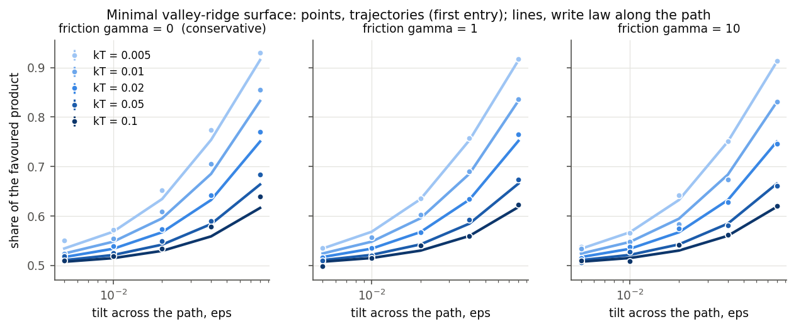
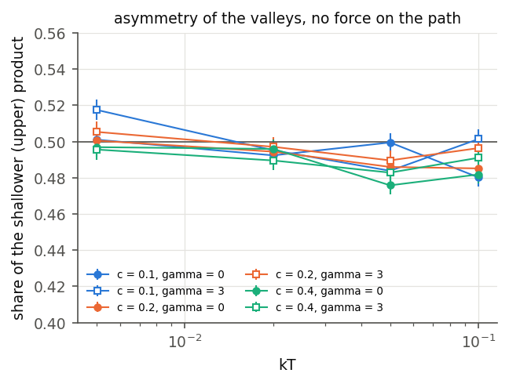
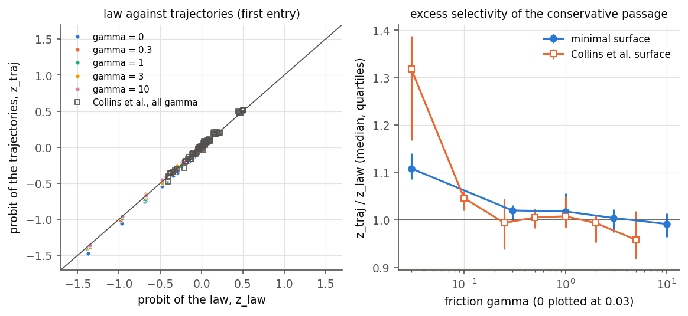
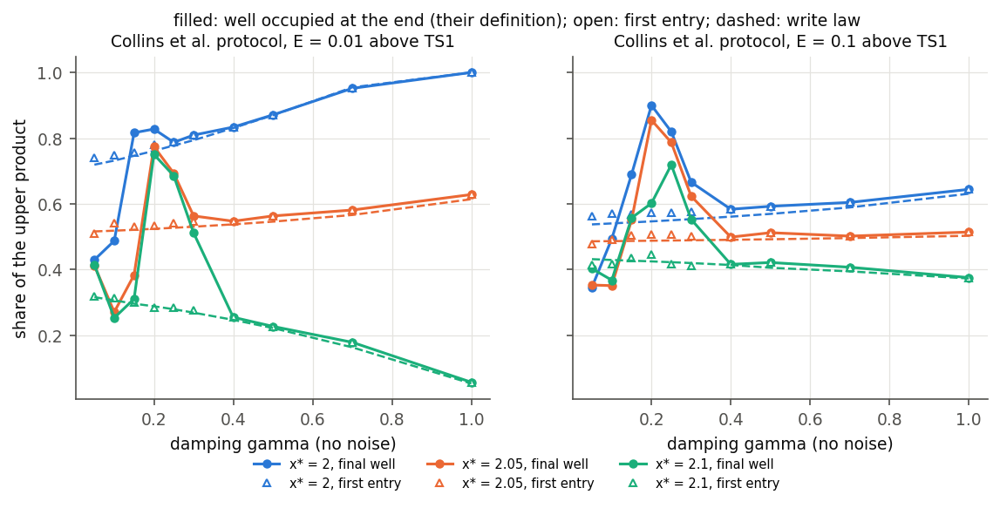
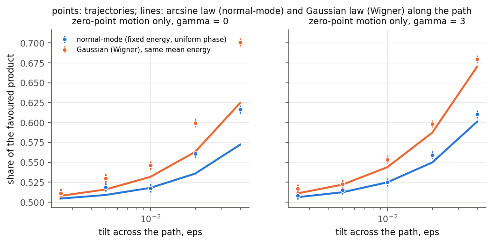
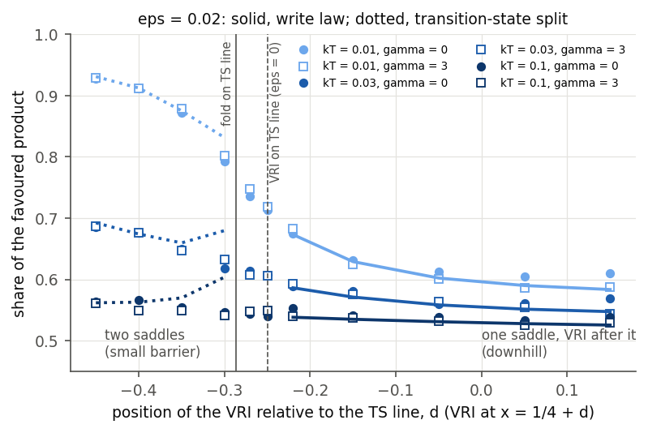
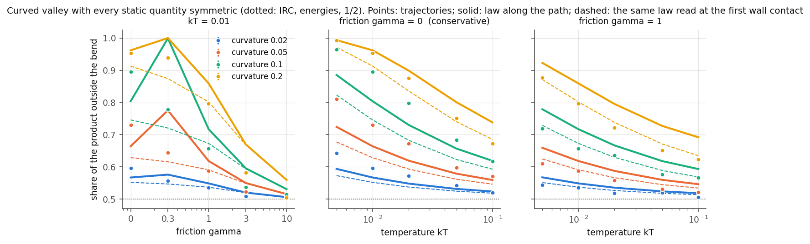
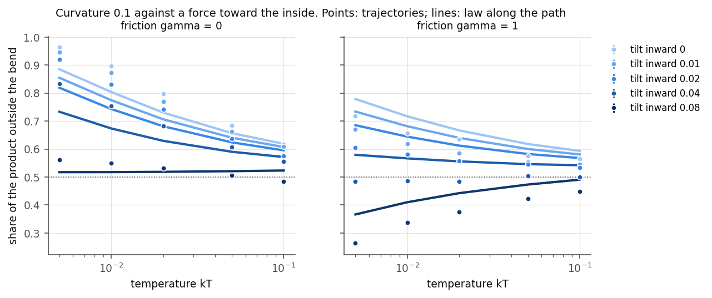
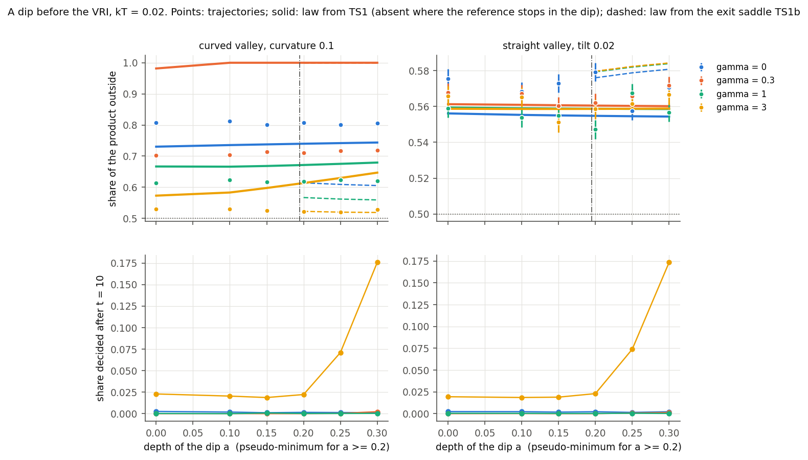
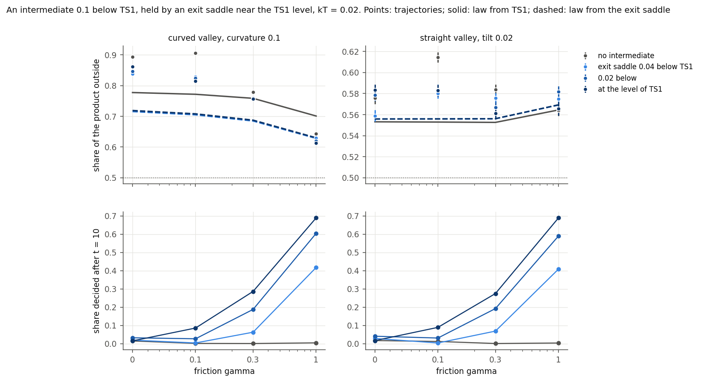

# Product branching after a valley-ridge inflection and the swept-pitchfork write law

## Question and answer

After a transition state (TS1), a reaction path can reach a valley-ridge inflection (VRI), where the curvature across
the path changes sign and one valley becomes two. Seen from the coordinate across the path, this is a pitchfork
bifurcation swept by the motion along the path. The question was whether FieldBridge's write law for a swept pitchfork
with a bias and noise predicts the product ratio. The law states that, while the displacement across the path is
small, the displacement is Gaussian and its sign is set by the mean pushed by the asymmetry divided by the spread:
P = Phi(h I1 / sqrt(sigma0^2 + 2 D I2)). The test used two model surfaces, not molecules.

The answer has five parts.

1. When friction slows the motion along the path, the law predicts the ratio from static quantities of the surface
   and the incoming speed. Static here means the transverse force and the transverse curvature along the path, and
   the offset and frequency of TS1. The error is about half a per cent, on our minimal surface and on the surface of
   Collins et al. (2013).
2. In a conservative passage (no friction), the decision is not finished while the displacement is small. The
   trajectories are then more selective than the law, by 10-30 per cent in probit for thermal incoming speeds and by
   up to a factor of eight for fast fixed speeds.
3. The local Kondepudi-Nelson formula (constant pi^{1/4}) does not apply to these surfaces, because TS1 lies inside
   the time window in which the choice is made. The law has to be integrated along the path from TS1.
4. The two static classes of Yamaki et al. map onto the two sides of the unfolding of the bifurcation at the TS line,
   but only in a restricted sense, described in the class-mapping section. On the downhill side the write law holds.
   Where the valley of the minor product is born before the TS line, it has its own saddle above TS1, and the
   transition-state split of the Boltzmann weight on the TS line holds. Next to the boundary neither holds.
5. On a curved path, the centrifugal force kappa <s'^2> is a bias that no static quantity records. On a valley whose
   IRC, saddles and minima are all symmetric, trajectories favour the product outside the bend by up to 99:1. The law
   predicts the direction and size of this effect, but only to 0.02-0.12. A pseudo-minimum before the VRI leaves the
   ratio unchanged unless its exit saddle lies near the TS1 level. Even then the ratio is set by the descent after
   that saddle, and the law applies from it.

The transfer is partly prior art. Tao, Qiu and Subotnik (2023) gave the overdamped Gaussian ratio of a biased mean to
the thermal width before the VRI. The swept-pitchfork law along the path, its inertial and conservative forms, and the
class mapping were not found (see [PRIOR_ART.md](PRIOR_ART.md)).

## Models, the law and the trajectories

**Surfaces** ([ptsb.py](ptsb.py)). Masses are one.

- **Minimal surface:** V = 8/3 x^3 - 4x^2 + y^2/2 + (x - d) y^2 (y^2 - 2), with TS1 at the origin, the VRI at
  x = 1/4 + d, a ridge saddle TS2 at (1, 0) 1.33 below TS1, and two product minima 1.95 below TS1. Three
  asymmetries are added:
  - a tilt eps y, which is a uniform force across the path;
  - a cubic term c x y^3, which makes the two product valleys differ in shape and depth but puts no force on the
    line y = 0;
  - a shift d of the VRI through the TS line.
- **Collins surface:** the surface of Collins, Carpenter, Ezra and Wiggins, J. Chem. Phys. 139, 154108 (2013),
  eq. (2.1), for x* = 2.00, 2.05 and 2.10. The coefficients reproduce their Tables I and II and their IRC endpoints.

**The law along the path.** The reference path x_ref(t) runs along y = 0 from TS1 at the incoming speed, with
friction gamma. Linearizing across the path gives

    y'' = -gamma y' - V_yy(x_ref, 0) y - V_y(x_ref, 0) + sqrt(2 gamma kT) xi(t).

The mean, the response to the initial state and the noise covariance of this equation are integrated together. The
initial state is the transverse equilibrium at TS1: thermal, a Wigner Gaussian, or the quasiclassical normal-mode
ellipse.

- For a Gaussian initial state, P = Phi(mean/spread) at the largest amplification.
- For normal-mode sampling (fixed energy and a uniform phase) the distribution is not Gaussian but an arcsine:
  P = 1/2 + arcsin(m/A)/pi, averaged over the Boltzmann distribution of quanta.
- In the overdamped limit the law reduces to Kondepudi-Nelson. On this surface the noise ratio is Gamma = kT/6
  whatever the friction.
- For a conservative passage entered adiabatically, it reduces to P = Phi(pi^{1/2} f / (J R)^{1/2}). Here f is the
  transverse force, J the mean transverse action at entry and R the rate at which the transverse stiffness falls.
  [airy_check.py](airy_check.py) confirms this against the linear equation to within 0.0035 (0.0004 for an entry far
  from the VRI).

**Trajectories** ([engine.py](engine.py), [scan.py](scan.py)). Trajectories use BAOAB Langevin dynamics, or velocity
Verlet without friction, with dt = 0.005. They start on the dividing line through TS1. A trajectory is assigned at
its first entry into a product basin, with the side read from the TS2 ridge. Family E, Collins's own protocol, also
assigns by the well occupied at the end, which is their definition. Trajectories that return over TS1 are excluded
from the ratio, and their share is recorded. The scan has 376 parameter points and 3.46 million trajectories, run on
one RTX 3090 in 244 s. The laws come from the surfaces alone (`scan.py law`).

## Results

### With friction, the law predicts the ratio

**Minimal surface with a tilt** (125 points: five frictions, five temperatures, five tilts, thermal incoming speeds).
The table gives the mean and largest difference between the trajectory share and the law.

| gamma | mean abs(dP) | largest abs(dP) | median z_traj / z_law |
|---|---|---|---|
| 0.3 | 0.004 | 0.010 | 1.02 |
| 1 | 0.005 | 0.015 | 1.02 |
| 3 | 0.004 | 0.014 | 1.00 |
| 10 | 0.004 | 0.011 | 0.99 |

**Collins surface** (63 points). For gamma from 0.5 to 5 the mean difference is 0.004-0.005 and the largest 0.011.

**Temperature.** For a tilt, selectivity falls with temperature, because the push is fixed while the thermal width
grows. At eps = 0.08 and gamma = 1, the share of the favoured product falls from 0.92 at kT = 0.005 to 0.62 at
kT = 0.1. The law follows the trajectories at every temperature.

**The local formula.** At gamma = 10 the local Kondepudi-Nelson formula gives a probit about 0.71 times that of the
law along the path, while the trajectories agree with the path law. Examples:

| kT | eps | trajectories | path law | local formula |
|---|---|---|---|---|
| 0.005 | 0.08 | -1.36 | -1.35 | -0.96 |
| 0.02 | 0.08 | -0.66 | -0.68 | -0.48 |

The local formula assumes a sweep that starts far before the VRI. Here TS1 sits 0.25 before the VRI, inside the
decision window, whose length is about (dx/dt) r^{-1/2} = 0.61. The offset of TS1 from the ridge line, relative to
the thermal width at TS1, carries much of the decision. This is why TS-geometry predictors (bond-length differences,
lateral offsets) work as well as they do.

**FieldBridge.** The overdamped transverse model is the specification
[ptsb_transverse_overdamped.json](ptsb_transverse_overdamped.json), with the path coordinate as the control.
- `memory noise-ratio` finds a continuous pitchfork at s = 1/4 with cubic coefficient -1. Its measured constants are
  1.20 +- 0.12 at Gamma = 0.05 and 1.43 +- 0.12 at Gamma = 1, against pi^{1/4} = 1.33.
- `memory codiscover --target symmetric-write` reaches the symmetric write, with derivation
  S(reflection) C R(pitchfork) K L and constant 1.29 +- 0.11.

Reports: [fieldbridge_noise_ratio](fieldbridge_noise_ratio/noise_ratio.md) and
[fieldbridge_codiscover](fieldbridge_codiscover/).

### The force on the path decides, not the depths of the wells

The cubic term makes the two product wells differ by 0.15, 0.31 and 0.64 in energy, but puts no force on the line
y = 0. The law therefore predicts 1/2. The trajectories give 0.476-0.517 at all temperatures and both frictions
(24 points, largest deviation 0.024). A Boltzmann ratio of the product wells would give more than 99.9 per cent for
the deeper well at the lowest temperatures.

### The conservative passage is more selective than the law

Without friction the median ratio z_traj / z_law is 1.11 on the minimal surface and 1.32 on the Collins surface
(thermal speeds). With fast fixed speeds the gap grows, as the table shows for kT = 0.005 and eps = 0.04 on the
minimal surface.

| incoming speed | trajectories P+ | law P+ | returned over TS1 | amplification before the wall |
|---|---|---|---|---|
| 0.3 | 0.212 | 0.253 | 7 per cent | 3.0 |
| 1 | 0.113 | 0.262 | 34 per cent | 2.5 |
| 3 | 0.033 | 0.272 | 48 per cent | 1.9 |

The mechanism is visible in these numbers. Between the VRI and the far wall, the growing transverse solution is
amplified only two- to threefold. The displacement therefore reaches the size of the wells before its sign is fixed,
and the asymmetry keeps acting in the nonlinear motion. Trajectories that have not left the ridge region bounce back
over TS1. Those that reach a product on the first pass are the ones displaced early, which is mostly toward the
favoured side.

Collins et al. reached the same picture from bundle dynamics. They found that the far wall, not the VRI, decides,
except under strong dissipation. Friction of order one (gamma about 0.3 on the minimal surface and 0.25-0.5 on the
Collins surface) slows the motion along the path enough for the linear stage to finish, and the law then holds.

### First entry against the well occupied at the end

This is Collins's protocol: a fixed energy above TS1, damping without noise, 60 points. The law predicts the
first-entry ratio with a mean error of 0.013 (largest 0.032) at every damping. The well occupied at the end departs
from the first entry for gamma below about 0.3. For x* = 2.05 and E = 0.01 it is 0.27 at gamma = 0.1 and 0.77 at
gamma = 0.2, while the first entry stays at 0.53-0.54. This is the non-monotonic dependence on friction that Collins
et al. reported. It arises from ridge recrossings after the first entry, which the law does not describe.

### Zero-point motion

The transverse mode carries only its zero-point energy (hbar omega / 2 = 0.02). Two samplings with the same mean
energy give different ratios:

- At gamma = 3 and eps = 0.04, P+ is 0.390 with normal-mode sampling (fixed energy) and 0.320 with Wigner sampling
  (Gaussian).
- The arcsine law and the Gaussian law reproduce each case, with a largest error of 0.011.
- Fixed-energy sampling is less selective at small bias. It becomes completely selective once the push exceeds the
  amplitude of the zero-point ellipse, which a Gaussian never does.

Without friction both samplings are again more selective than their laws (largest error 0.076).

## The static classes and the unfolding

**Strings on these surfaces** ([classes.py](classes.py), results/classes.json). We ran a converged double-ended
string from TS1 to the product the IRC does not reach.

- On every asymmetric surface, the string descends into the valley of the IRC product and climbs over TS2.
- Its "small barrier" is therefore TS2 seen from that dip. On the minimal surface it is 0.001-0.71 above the dip and
  its top lies 1.30-1.33 below TS1. On the Collins surface it is 1.5-2.6 above the dip and 3.97 below TS1.
- The string is downhill only where the IRC runs along the ridge to TS2: the symmetric surface, and the cubic family,
  which has no force on the path.

On these surfaces, then, the string class records whether the IRC ends at the ridge saddle, not how the minor valley
is born. Every surface in this family has its only other saddle (TS2) below TS1, so no string from TS1 can have a
maximum above TS1. The small barrier 0.27 kcal/mol above TS1 that Yamaki et al. report for their entry 28 needs a
second saddle near the TS line.

**The cusp at the TS line.** Moving the VRI behind the TS line (d < -1/4) supplies that saddle. At eps = 0.02 the
fold that creates the minor valley crosses the TS line at d = -0.287. Behind it, TS1 has a partner TS1' for the minor
product, 0.012-0.024 above TS1, with a hill between the two (an index-2 saddle) 0.013-0.077 above TS1. That hill is a
small barrier above TS1 in Yamaki's sense.

Family F has 66 points. It uses the full Boltzmann weight on the TS line, two frictions and three temperatures.

| Side of the cusp | Prediction | Mean abs(dP) | Largest abs(dP) |
|---|---|---|---|
| Downhill, d >= -0.22 (minor valley born after the TS line) | write law | 0.007 | 0.027 |
| Two saddles, d <= -0.35 | TS split of the Boltzmann weight | 0.006 | 0.020 |
| Next to the boundary, d = -0.30 | TS split | 0.050 | 0.062 |

At d = -0.30 the trajectories carry more of the minor product than the static split: 0.207 against 0.168 at
kT = 0.01. The trajectories vary smoothly across the boundary.

**Where the mapping holds and where it does not.**

- A downhill connection, in the sense of a minor valley born at a fold or pitchfork after TS1, corresponds to the
  write law. A small barrier above TS1, in the sense of a minor valley born before the TS line with its own saddle,
  corresponds to transition-state selection. Both selectivities fall with temperature, for different reasons: the
  thermal width against a push, and a Boltzmann factor.
- This is the crossover that FieldBridge's noise ratio describes between the linear stage and the activated regime.
  Here the place where the barrier between the valleys appears plays the role of Gamma.
- The mapping fails in a band of about 0.05 in d around the boundary, where neither the law nor the split holds.
- It fails for "small barriers" that are only TS2 seen from the major valley. Those lie below TS1 and say nothing
  about the birth of the minor valley.
- It is a statement about these two-dimensional surfaces. Curved paths and pseudo-minima are treated in the next
  section; molecules with additional modes were not modelled.

## A curved path and pseudo-minima before the bifurcation

**Surface** ([curved.py](curved.py)). The minimal surface is written in coordinates s along the valley and n across
it, and the valley is laid along a circular arc of curvature kappa. The potential depends on (s, n) exactly as on the
straight surface. The stationary points, their energies, the IRC and every static quantity along the path are
therefore unchanged by the curvature. With no tilt, the IRC runs along the valley floor to the ridge saddle TS2, and
the two products have the same energy. The curvature enters only through the kinetic energy. In this family the VRI
sits at s = 1/2 (d = 0.25). Static analysis predicts 50:50 for every curvature.

**The law along a curved path.** Linearizing the equations of motion about the reference path gives

    n'' = -gamma n' - [V_nn - kappa^2 v^2] n - V_n - kappa <s'^2> - 2 kappa v dv + noise.

The term kappa <s'^2> is the centrifugal force toward the outside of the bend. It acts as the bias of the write law,
and it is set by the kinetic energy along the path, not by the shape of the surface. This is Carpenter's dynamic
matching expressed as a bias. With strong friction <s'^2> falls to kT, and the bias becomes the entropic force
kappa kT of the larger room outside the bend. The fluctuations of the speed dv are integrated with the transverse
motion.

### Curvature alone selects the outside product

- **Size of the effect.** Without friction, at kT = 0.005, the share of the product outside the bend is 0.64, 0.81,
  0.97 and 0.99 for curvature 0.02, 0.05, 0.1 and 0.2.
- **Temperature.** The selectivity falls as temperature rises. At curvature 0.1 without friction, the outside share
  is 0.97 at kT = 0.005 and 0.62 at kT = 0.1. The push comes from the kinetic energy gained in the descent from TS1
  to the VRI, which does not depend on temperature, while the thermal width across the path grows.
- **Incoming speed.** Faster arrival strengthens the push. At curvature 0.05 and kT = 0.005, fixed incoming speeds
  of 0.3, 1 and 3 give 0.82, 0.93 and 1.00.
- **Friction.** Friction removes the effect, because it removes the kinetic energy that carries the push. At
  gamma = 10, every curvature and temperature gives 0.49-0.52.

**Curvature against a force toward the inside** (family H, curvature 0.1).

- **Friction reverses the favoured product.** With an inward tilt of 0.04 at kT = 0.005, 83 per cent of products are
  outside without friction and 48 per cent with gamma = 1. The tilt is a static force, which friction does not
  weaken, while the centrifugal push is lost.
- **Temperature reverses it weakly at the strongest tilt.** With an inward tilt of 0.08 and no friction, the outside
  share is 0.56 at kT = 0.005 and 0.485 at kT = 0.1. The law predicts 0.52 at every temperature, with no reversal.

**Accuracy of the law.** The law gives the direction and size of the effect. Its accuracy is set by where the
decision is read: at the largest amplification beyond the VRI, as on the straight surfaces (fixed before the
comparison), or at the first contact of the reference path with the product wall (chosen after it). The table gives
the mean absolute difference between the trajectory share and the law, over 20 points per row.

| friction gamma | read at largest amplification | read at first wall contact |
|---|---|---|
| 0 | 0.038 | 0.058 |
| 0.3 | 0.124 | 0.028 |
| 1 | 0.039 | 0.009 |
| 3 | 0.037 | 0.035 |
| 10 | 0.020 | 0.020 |

For a tilt on the same surfaces, the readout does not matter and the law holds to 0.005-0.02 (families I and J
below). For curvature it does. The push kappa v^2 is largest at the bottom of the descent and near the product wall,
where the transverse motion is no longer small. At gamma = 0.3, reading at the largest amplification includes the
return of the reference path from the wall, after the trajectories have already entered a product. With friction the
trajectories are less selective than the law: by 0.04 on average at gamma = 3 and 0.02 at gamma = 10, and by at most
0.10.

The reason is a second-order effect of the curvature. The inside of the bend is shorter, so a trajectory displaced
inward runs ahead along the path. It reaches the unstable region earlier and is amplified more, which acts as a push
toward the inside. A Gaussian closure of this term has the right sign at gamma = 10 (0.540 becomes 0.521, against
0.508 from trajectories). The closure grows with the transverse variance, however, and diverges at gamma <= 1. It is
kept in the code as an option and is not used.

### A pseudo-minimum on a downhill path changes nothing

**Setup** (family I). A Gaussian dip of depth a sits at s = 0.25, before the VRI.
- For a < 0.2 the dip is a shoulder.
- For a >= 0.2 it is a true intermediate, with an exit barrier of 0.01-0.07. Its exit saddle lies 0.42-0.45 below
  TS1.

**Result.** The ratio does not change.
- At every friction (0 to 3) and temperature (kT 0.02 and 0.05), the outside share varies by at most 0.017 over
  a = 0-0.3 on the curved valley and 0.021 on the straight valley with a tilt.
- Trajectories cross the dip with the energy of the descent from TS1. Only at gamma = 3 and a = 0.3 are more than
  10 per cent held beyond t = 10 (18 per cent).

**Law.** The law from TS1 needs no change while its reference passes the dip.
- For the tilt it holds to 0.004-0.015 at every friction.
- For curvature it carries the readout errors of the previous section.

### An intermediate held by an exit saddle at the level of TS1

**Setup** (family J). An intermediate lies 0.1 below TS1, between TS1 and an exit saddle TS1b at the level of TS1,
or 0.02 or 0.04 below it. The VRI follows at s = 0.7.
- At gamma = 1 and kT = 0.02, 42-69 per cent of trajectories decide after t = 10. At kT = 0.02 and gamma >= 0.1, up
  to 11 per cent are still in the well at t = 300; those are excluded from the ratio.

**Results**
- **The held intermediate reduces the outside share only modestly.**
  - At curvature 0.1 and kT = 0.02 the reduction is from 0.91 to 0.81-0.83 at gamma = 0.1, and from 0.64 to
    0.61-0.63 at gamma = 1.
  - Without friction the reduction is from 0.89 to 0.84-0.86. This is consistent with the transverse energy
    picked up in the well.
- **Held trajectories choose like the rest.** At gamma = 1 with the exit saddle at the level of TS1, the trajectories
  decided after t = 10 have outside share 0.61, against 0.62 for the earlier ones (0.57 against 0.56 for the tilt).
  The outcome is set after the exit saddle.
- **Why the push survives.** Without friction, the kinetic energy at the VRI is the total energy minus the potential
  there. Whatever happens before the last saddle, the trajectories leave TS1b with nearly the same energy and gain
  the same speed on the way down. The centrifugal push is acquired downhill of the last saddle, so an intermediate
  cannot erase it. It can only add transverse energy, or give friction more time to act.

**Law.** The law started at TS1b, with thermal speeds and the thermal transverse state there:
- holds at gamma = 1 to 0.006 for curvature and 0.005 for the tilt;
- for the tilt, holds to 0.005-0.021 at every friction;
- for curvature at gamma <= 0.1, the trajectories exceed it by 0.10-0.12. This is the conservative excess seen on
  all surfaces.

### What this adds to the class mapping

- **Path curvature.** A curved path is a source of selectivity that no static quantity records. On these surfaces
  the IRC, the stationary points and their energies are those of a symmetric bifurcation, while trajectories favour
  the outside product by up to 99:1.
- **Pseudo-minima.** A pseudo-minimum or shallow intermediate before the VRI does not change the ratio, unless its
  exit saddle lies near the TS1 level and friction is present.
- **Even then.** The ratio is fixed by the descent after the exit saddle. The law applies from that saddle, as if it
  were TS1.

## Summary: where the law holds and where it fails

- **It holds** when the transverse instability grows through more than a few e-folds before the motion along the path
  meets the product wall. In these models that means friction of order one or more (gamma >= 0.3 on the minimal
  surface, >= 0.25-0.5 on the Collins surface), or a slow incoming speed. The law must be integrated from TS1 along
  the path. The local Kondepudi-Nelson constant undershoots by about 30 per cent here.
- **It fails** in four situations.
  - **The decision ends in the nonlinear stage.** In a conservative passage with amplification 2-3 before the wall,
    trajectories are more selective than the law, up to eightfold in probit at fast speeds.
  - **Recrossing.** 7-48 per cent of conservative trajectories return over TS1, and the survivors are a biased
    subset.
  - **Late re-sorting.** With weak damping, the well occupied at the end differs from the first entry. The law gives
    the first entry only.
  - **Next to the cusp.** Within the band where the minor valley is born on the TS line, neither the law nor the
    static split holds.
- **On a curved path** the push is the centrifugal force kappa <s'^2>. The law gives its direction and size: the
  outside share rises with curvature and speed and falls with temperature and friction. It is accurate only to
  0.02-0.12, depending on friction and on where the decision is read, because the push is largest where the
  transverse motion is no longer small. Friction and temperature can reverse the favoured product when curvature
  competes with a static force; the law misses the temperature reversal.
- **Pseudo-minima** before the VRI do not change the ratio on a downhill path. An intermediate held by an exit
  saddle near the TS1 level changes it modestly. The law then applies from the exit saddle.
- **Not tested:** more than two products (entries 29 and 30 of Yamaki et al.); curved paths in more than two
  dimensions; couplings to further modes.

## What molecular tests would need

Molecular tests are out of scope here. AIQM2 would serve for entries 1-27 of Yamaki et al. and DFT for 28-33. They
would need:

- the IRC from TS1 and the Hessian along it, which gives the transverse curvature V_yy(s) and the force on the IRC line
  V_y(s) in the bifurcating mode, projected with the reaction-path Hamiltonian so that the coordinate across the path
  is defined continuously;
- the speed along the path from TS1 (thermal or quasiclassical) and an estimate of the effective friction from the
  remaining modes (energy flow out of the two-mode subspace on the time scale of the passage);
- the sampling actually used by the trajectories (normal-mode or Wigner), since the law's denominator differs between
  them;
- for each reaction, the amplification of the transverse mode between the VRI and the product region. This decides
  whether the linear-stage law applies or the trajectories will be more selective;
- for small-barrier connections, all saddles near the TS line (TS1', the hill between), to separate a second
  transition state from TS2;
- the curvature of the IRC between the last saddle before the VRI and the product region, in mass-weighted
  coordinates, with the kinetic energy gained along it: the centrifugal push kappa v^2 is the bias of the law on a
  curved path, and it is not visible in any static quantity;
- for pseudo-minima, the energy of the exit saddle relative to TS1 and an estimate of the friction, which decide
  whether the law starts at TS1 or at the exit saddle;
- the published trajectory ratios with their counting rules (first entry or final well) and the share of recrossing
  trajectories.

## Reproduction

| Step | Command (from examples/ptsb) |
|---|---|
| Trajectories | `python scan.py traj --backend torch --out results/traj.json` (the NumPy backend works without a GPU but is much slower) |
| Laws | `python scan.py law --out results/law.json` (about 6 minutes) |
| Static classes | `python classes.py --out results/classes.json` |
| Figures and summary | `python analyse.py` (writes figures/ and results/summary.json) |
| Airy limit | `python airy_check.py` |
| Curved valley and pseudo-minima | `python curved_scan.py traj --backend torch --only G,G1,H --out results/curved_traj_GH.json`, the same with `--only I` and `--only J` (`results/curved_traj_I.json`, `_J.json`; 2.48 million trajectories plus 0.64 million, about 7 minutes on one RTX 3090), `python curved_scan.py law --workers 20 --out results/curved_law_all.json` (about an hour on 20 cores), `python curved_analyse.py` |
| FieldBridge | `fieldbridge memory noise-ratio ptsb_transverse_overdamped.json --out-dir fieldbridge_noise_ratio --gammas 0.05,1`, and `fieldbridge memory codiscover ptsb_transverse_overdamped.json --target symmetric-write --out-dir fieldbridge_codiscover` |

Seed 20261030, NumPy 1.24 and torch 2.0.1 on the GPU node; laws with SciPy 1.14 on the laptop.
